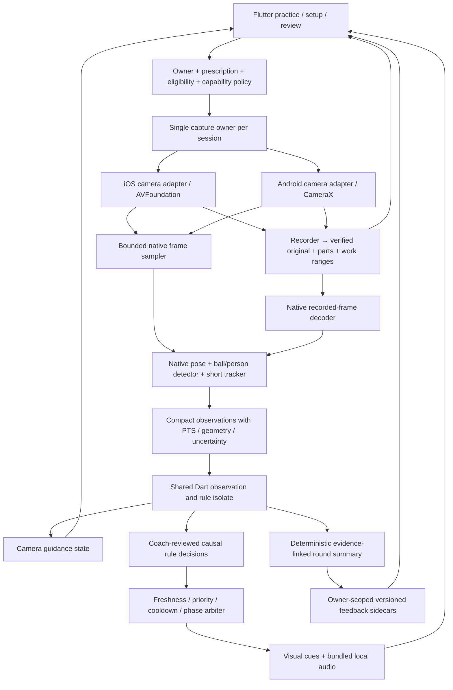
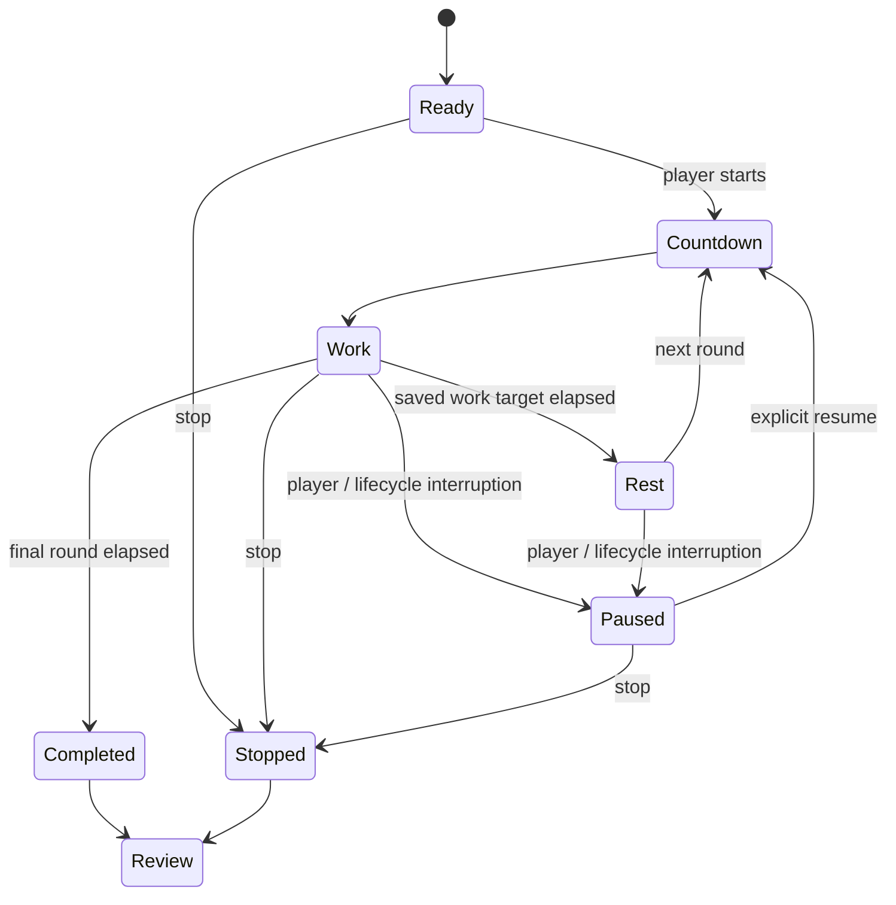
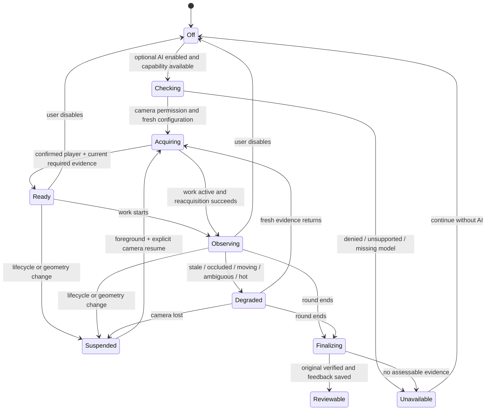

# Live AI coaching implementation plan

**Soccolo individual app · 1 November 2026 · planning proposal**

Repository baseline: `main` at `a3deef5c0b82bb7dd5c1b3da50298d6abbc3a562`; mobile source version `0.2.0+63`. This plan covers adult players and parent-managed children on iPhone and Android. It does not cover the separate club app.

**Status:** implementation has not started. All new designs, cue thresholds, performance budgets, dataset sizes and release criteria below are **proposed**, requiring engineering, qualified coaching, product and privacy review. No accuracy or device-performance results are claimed.

## 1. Executive recommendation and first-version scope

Deliver in this order:

1. **Prove capture feasibility and repair data prerequisites.** Test recording plus frame analysis on representative physical iPhones and Android phones before choosing a capture integration. Fix prescription-based analysis eligibility and define typed platform capabilities.
2. **Ship optional camera guidance on both platforms.** Show current framing, detection confidence and tracking status before and during practice. Preserve manual setup, recording without AI and complete no-camera practice.
3. **Validate recorded-round observations and feedback for two drills.** Start with **D01 Inside touches** and **D15 Sole taps**. Use deterministic, coach-approved rules, short controlled messages and replay evidence. Assess visible movement patterns; do not infer force, balance quality or correct contact surface from pose alone.
4. **Run those rules live without speaking to users.** Replay recorded inputs causally, then run consented device sessions in shadow mode. Measure the effects of dropped frames, delay, device heat and interruptions.
5. **Enable individual live cues only after their own gates pass on both platforms.** Ship fewer cues if needed. A camera-guidance release is useful independently; a release marketed as live coaching on both platforms must have an explicitly approved common cue set on each.

**Yes: validate recorded-round feedback before enabling the same coaching rules live.** A recording allows coaches to inspect the evidence, identify unobservable cases and check whether the wording follows the observation. This is necessary but insufficient: an offline rule can use future frames or more compute than a live device. Implement a causal rule core, test it with live-equivalent sampling and separately validate actual live delivery.

### First useful version

| Capability | Proposed scope |
| --- | --- |
| Core practice | Existing timers, plans, rest, completion and reflections; recording and AI remain optional. |
| Camera guidance | One player, one active ball, required body regions, framing, stable camera and measurable image-quality issues. Rear 1× lens and one validated orientation first; additional views gated. |
| Recorded feedback | D01 and D15, at most two supported observations, one positive observation where supported, one or two improvement points, replay moments, uncertainty and a next action. |
| Live feedback | Infrequent execution cues from the rule matrix, independent per cue/platform/view gates; no conversational assistant. |
| Technique coaching | Reviewed instructional reminders may accompany a demonstration. **No automated technique correction is enabled in v1.** Contact surface, pressure, ankle locking, joint loading and balance quality are not established by the current evidence. |
| Processing | Local native inference; shared Dart rules, presentation and storage. No video-processing service or language model needed. |
| Platform parity | Same core journeys, vocabulary, completion semantics and fallback on iPhone/Android. Support badges reflect actual device/drill capabilities. |
| Age policy | Approved age/content bands and adult self-management; unknown eligibility permits suitable basic practice but withholds age-dependent cues. Child AI participation is parent controlled and optional. |

**First milestone:** an instrumented, internal capture-and-guidance spike, with the duration-contract repair alongside it. The spike must demonstrate a playable saved original, bounded inference, trustworthy timestamps and clean interruption recovery on both platforms. Do not commit to a full native rewrite or promise live coaching until that experiment passes.

## 2. Verified current state and platform gaps

### Evidence boundaries

This document starts from [the individual-app release review](individual-app-release-review-2026-11-01.md) and verifies relevant findings against the checkout. Fresh work here was read-only source inspection, dependency-source inspection, Git/worktree status, model file-size inspection, a calculation of the current duration predicate, and official-documentation research. No Flutter suite, native compilation, phone installation, accuracy benchmark, cloud build, deployment or private-video upload was run for this plan.

The review's 305 passing/11 skipped default Flutter tests and its four feature-enabled failing cases are **prior reported test evidence**, not new results from this task. Their historical 20-second fixtures and the source branch responsible for rejection are present. Physical-device findings remain open.

| Evidence class | Verified position |
| --- | --- |
| Current source | Main SHA above; version 0.2.0+63. The release-review Markdown was already untracked before this task; it is not application code. |
| Installed app | [31 October checkpoint](https://github.com/sumarahmed/Soccolo-app/blob/main/apps/mobile/WORK_CHECKPOINT_2026-10-31.md) records Build 62 as latest confirmed installed iPhone build. No device inventory was inspected here; do not imply Build 63 is installed. |
| Android artifact | Checkpoint records a successful local debug APK. This establishes compilation reported in that checkpoint, not release signing, real-device performance or analysis support. |
| Desktop pipelines | [Acceptance register](accepted-local-pipelines.md) lists ten accepted local analyser selections/variants and D24 separately as no-touch. They are development evidence with known errors, not mobile or technique certification. Its older “uncommitted Build 63” wording is superseded by the checkpoint and current Git SHA. |
| Calibration worktree | Separate detached checkout at `c979c8af2f9829cd077b6ca5e82bd1e6a9ad6e36`, with modified/untracked calibration files. It is not merged into main. `UnavailableCalibrationProvider` and `FakeCalibrationProvider` exist; `liveAnalysis = false`. |
| Proposed work | Every new component, capability manifest, rule and release gate below. No production live coach currently exists. |

### Reuse, extensions and new implementation

Paths in this table are relative to `apps/mobile/`.

| Area and source | What is present | Reuse / required change |
| --- | --- | --- |
| `lib/main.dart`, root `codemagic.yaml`, root `.github/workflows/foundation-security.yml` | `FAMILY_PILOT` selects the family shell; otherwise the legacy shell. iPhone build commands set it; Android debug command does not. | Establish one production configuration and smoke-test the real entry point on both platforms. AI gates must not accidentally expose technical screens. |
| `guided_practice_flow.dart`, `practice_page.dart`, `practice_controller.dart`, `practice_lifecycle.dart` | Guided runs restore drill snapshots; routes choose clips/session/no-camera. Work/rest/countdown/pause/completed/stopped states exist. | Reuse timing/completion. Add an independent AI state machine; confidence loss must not change completion or stop the timer. |
| `local_preferences.dart`, `training_catalog.dart` | Timing snapshots; custom work 15–600 s and rest 0–600 s. Default 60–30–60. D12 self-paced; D24 has no touch analysis. | Carry immutable prescription through every review/analysis path. Add explicit age/content/capability policy instead of overloading acceptance flags. |
| `camera_feasibility_page.dart`, `drill_recording.dart`, `drill_recording_page.dart` | Real clip recorder despite historical filename. Silent recordings, lead-in and work metadata, `targetWorkMs`, attempt/drill/plan IDs, interruption handling and grouped rounds. | Reuse saving and recovery. Insert capture-owner adapter and timestamp mapping; validate inference does not damage original capture. |
| `full_session_page.dart`, `full_session_manifest.dart`, `full_session_recovery.dart` | Source parts, chapters, gaps, verified parts and recovery. Manifest v1. iOS-only device/storage preflight paths. | Extend optional metadata with explicit drill/round/prescription IDs and camera epochs. Add Android storage/media inspection. Do not rewrite chapter timing from display labels. |
| `practice_setup_guide.dart` | iOS-only transient BGRA stream; one request at a time, sampled at least 450 ms apart; three booleans. Stops stream before capture. `SetupCheckProgress.observe` OR-latches prior successes. | Reuse UI/recovery entry, not “ready” semantics. Require simultaneous recent evidence, expiry, region states and stable association. Current checks can remain green after a region disappears. |
| iOS `Runner/AppDelegate.swift`, `PracticeVision` | Setup uses Apple Vision body pose and YOLOv3 Tiny sports-ball/person detections. “Feet” means two confident ankles, not visible soles. Has crop retry for small balls. | Extend to timestamped structured observations. Do not label ankles as confirmed visible shoe surfaces. Extract services from the large file only as needed. |
| iOS `TinyPracticeAnalyser.swift`, `SoccoloFlow.mm`, `PracticeMotionCounter.swift` | Saved-video analysis using YOLOX Tiny, MediaPipe pose, OpenCV flow and native motion rules; shared evidence can feed Dart counter. Memory/thermal checks exist. | Reuse model loading, preprocessing, bounded flow concepts and diagnostics after tests. Current offline implementation accumulates evidence and can use later frames; do not run it unchanged in a live callback. |
| Android `MainActivity.kt` | Camera-rate queries, app version and screen-awake channel only. Queries advertised rates, not delivered cadence. | **New:** vision/model service, decoded-video analyser, timestamp/geometry bridge, storage/media-inspection service. Voice commands and export are also missing, but are separate scope decisions. |
| `touch_analysis.dart`, `shared_touch_counter.dart` | Serial jobs, cache, explicit force/reanalysis, interrupted markers, unavailable states, saved baselines, iOS availability gate. Native trajectories are discarded after computation. | Preserve history contract. Separate new observation/coaching engine from legacy counts. Add per-capability gates and prescription resolver; no global “all drills supported” switch. |
| `practice_results_page.dart` | Clips derive range from `targetWorkMs`; full sessions use verified work chapters. Full-session drill/round identity is parsed from labels. | Typed `RoundContext` must carry expected duration, source segments and ownership. Label parsing becomes a legacy-only adapter. |
| `saved_practice_review.dart`, `review_video_player.dart`, `local_clip_playback_page.dart`, `full_session_playback_page.dart`, `family_video_hub.dart` | Playback, seeking, slow speed, round selection and demo comparison. | Add evidence chips and previous-round comparison, precise source-part seeks and missing-source handling. Replace unrelated demos before player release. |
| `touch_history.dart`, `touch_analytics.dart`, `practice_journal.dart`, `practice_facts.dart` | Player-scoped aggregates; historical result IDs; previous durable files; same drill/duration/algorithm bests; practice facts distinct from estimates. | Add feedback sidecars; do not change IDs or overwrite historical counts. Strengthen comparable-result keys with unit and acquisition/rule versions. |
| `family_pilot_store.dart`, `family_account_data.dart`, `guardian_lock.dart` | Account/player directory isolation, archive/deletion, guardian PIN/biometric flow. Age bands: 5–7, 8–10, 11–18, outside, unknown. | Bind owner once per operation; add adult self-managed eligibility and consistent content enforcement. PIN is an authorization mechanism, not legal guardianship proof. |
| `saved_exports_page.dart`, `local_export_page.dart` | iPhone export/share; Android export explicitly unavailable. Share actions do not request guardian authorization. | Parent authorization for child originals/feedback leaving app. Do not add feedback sharing until protected end to end. Android share/export parity is a wider core-release dependency if advertised. |
| `practice_feedback.dart`, `practice_voice.dart`, `practice_music.dart`, `practice_voice_control.dart` | Bundled sounds/spoken counts, music ducking hooks, interruption handling. iOS on-device speech commands; no general speech-output channel in `PracticeVoice`. Android microphone permission removed. | Add one cue arbiter and bundled reviewed cue recordings; do not assume arbitrary TTS exists. Voice commands remain separately optional/platform gated. |

### Duration defect: confirmed source path and proposed repair

1. `LocalPreferences.configureDrill` snapshots the chosen work duration.
2. Clip metadata writes `targetWorkMs` in `camera_feasibility_page.dart`.
3. `PracticeReviewRound.clips` uses that value to form a work interval.
4. `TouchAnalysis.run` accepts start/end/eligible, **not a prescription**.
5. `TouchAnalysis._run`, lines 340–349 at this SHA, reloads the catalogue and rejects if `abs(end - start - definition.workSeconds * 1000) > 250`, before native availability.

Evaluating this exact predicate against the current D01 catalogue yields:

| Supplied complete work range | Current catalogue | Duration gate |
| --- | --- | --- |
| Historical 20 s | 60 s | Reject |
| Custom 30 / 45 / 90 s | 60 s | Reject |
| 60 s | 60 s | Pass duration check only |

This is a source-level predicate reproduction, not a new end-to-end Flutter or inference test. The affected historical fixtures remain in `build61_shared_analysis_test.dart`, `build62_milestone_test.dart`, `saved_review_baseline_test.dart` and `build58_analysis_test.dart`.

Repair design: resolve a validated immutable `SessionPrescription` plus actual work range before analysis. Eligibility depends on the saved target, completion state, source integrity and continuity, not today's default. Keep the current 250 ms tolerance initially as a **compatibility policy**, then validate it against device timestamps. Never allow this tolerance to hide large capture gaps. Missing historical prescription means unknown completeness, not “use 60 s.” Section 7 defines migration and partial-round behavior. Do not “fix” the issue by changing historical tests to 60 s.

### Defects and prerequisites to resolve first

- Duration mismatch and missing explicit full-session prescription/round identity.
- Latched setup successes, absent expiry and absent selected-player association.
- Android native observation, analysis, metadata and storage gaps.
- Highest-advertised-FPS capture policy: useful existing rate negotiation, but unsuitable as an unmeasured default for concurrent inference.
- Global analysis flags and drill acceptance values do not encode phone/drill/model validation.
- Production content remains `internal-local`/placeholder; demonstrations and coach/rights approval are incomplete.
- Adult profile path, child eligibility enforcement and child media egress need closure.
- Shipping configuration/signing mismatch and feature-enabled test regressions.
- Privacy/account deletion/support are wider public-launch blockers from the release review. The AI project must coordinate with them rather than imply this plan alone makes the app store ready.

### Calibration reuse boundary

Read-only inspection of `C:/Users/Home/Documents/SoccerApp/player-calibration-foundation/apps/mobile/lib/calibration/` and its `docs/player-calibration/README.md` confirms useful ownership, uncertainty, geometry, generation-guard and opaque-version patterns. Selectively port those patterns/tests after reconciliation with current main. Do not merge the worktree wholesale, copy manual body measurements into required onboarding, or treat fake-provider UI as real tracking. Its two-second freshness window is a prototype setting, not a validated live-coaching budget.

## 3. Platform and model decisions

Official sources were checked on 1 November 2026. Package APIs and vendor documentation establish capabilities, not Soccolo performance. Pin exact versions during implementation; do not upgrade because a search result shows a newer release.

### Capture integration options

Current lockfile: `camera 0.12.1`, `camera_android_camerax 0.7.4+8`, `camera_avfoundation 0.10.3`, `camera_platform_interface 2.13.1`.

| Option | Benefits | Limits and decision |
| --- | --- | --- |
| Existing Flutter camera plus `startVideoRecording(onAvailable: ...)` | Smallest spike; preserves record/recovery flows. Local pinned source implements recording with a frame callback on Android and iOS. | Raw frame copying crosses Flutter/native boundaries; public frame DTO lacks a source recording PTS. Establish cadence, clock accuracy and device combinations. Good first experiment; not automatically the final high-rate path. |
| Narrow maintained native extension to the federated camera implementations | One camera owner; take native buffers before Dart copying; preserve recorder lifecycle; add capture PTS, transforms, capabilities and compact observations. | Package maintenance and upstream-change tests. **Preferred production direction if the spike confirms the existing recorder remains dependable.** |
| Dedicated internal native capture plugin: AVFoundation / CameraX | Full control of camera session, writer, model scheduling and timestamps. | Highest scope: must revalidate orientation, preview, pause, storage and recovery. Choose only if a documented plugin constraint blocks the narrow extension. Never open a second camera session for analysis. |
| Camera2 alternative Android plugin | Possible diagnostic comparison if CameraX binding fails. | Does not remove hardware stream-combination limits or prove a better result. Requires a separate tested adapter; no automatic runtime plugin swap. |

Flutter documents that lifecycle management is the application's responsibility. Its camera feature list is not a promise that all recording/analysis combinations work on all phones. [Flutter camera 0.12.1](https://pub.dev/packages/camera/versions/0.12.1).

**Important distinction:** the pinned CameraX README says configurable `VideoCaptureOptions.streamOptions` are ignored. Its source at `lib/src/android_camera_camerax.dart:1141–1183` nevertheless handles `streamCallback`, retains analysis and subscribes to frames while recording. The iOS adapter passes an enable-stream flag to native capture. Therefore “Android cannot record and stream” would be incorrect. What remains unproved is useful concurrent throughput and trustworthy geometry/timestamps in Soccolo. [Pinned CameraX limitations](https://pub.dev/packages/camera_android_camerax/versions/0.7.4%2B8).

CameraX guarantees Preview + VideoCapture as a supported combination; adding ImageAnalysis depends on hardware/configuration. Probe the combination at the intended resolution/rate and handle binding failure. Use nonblocking latest-frame analysis and close each ImageProxy promptly; blocking producers can affect other use cases. [CameraX video architecture](https://developer.android.com/media/camera/camerax/video-capture), [CameraX image analysis](https://developer.android.com/media/camera/camerax/analyze).

On iOS, the pinned plugin uses sample buffers and an asset writer. Add a bounded analysis branch; never delay the writer for ML. Retaining capture buffers too long can starve other outputs. Latest-frame dropping belongs on the inference branch, not indiscriminately on the recording branch. [Apple frame-drop guidance](https://developer.apple.com/library/archive/technotes/tn2445/_index.html).

### Pose, ball and tracking options

| Component | Current / candidate | Packaging, rights and runtime | Recommendation |
| --- | --- | --- | --- |
| Apple Vision 2D pose | Current iOS setup; framework supplied, no bundled pose weights for that path. | iOS only; supported joint names/revisions must be checked. Current app checks ankles/torso. | Retain as guidance benchmark/fallback. It does not provide a shared Android implementation or prove foot contact surface. [Vision request](https://developer.apple.com/documentation/vision/vndetecthumanbodyposerequest). |
| MediaPipe Pose Landmarker Lite / Full | Already bundled and used for saved iOS analysis. 33 landmarks include ankle, heel and foot index. | `.task` bundles; local README identifies Apache-2.0. iOS Podfile pins Tasks 0.10.21. Android integration is new. Check exact binary terms, supported OS/ABI and telemetry separately. | **Primary shared pose candidate:** Lite for live feasibility; Full as offline/reference comparison. Do not assume Full is better enough to justify heat. Disable segmentation unless measured benefit. [Model guide](https://developers.google.com/edge/mediapipe/solutions/vision/pose_landmarker). |
| ML Kit Pose Detection base/accurate | Alternative with Android/iOS streaming modes. | Vendor API remains beta. Published size impact: Android about 10.1/13.3 MB; iOS up to 29.6/33.2 MB, including SDK/assets. SDK terms and disclosures require review. | Benchmark only if MediaPipe fails device or distribution requirements. A single prominent-person pose output is insufficient for multi-person ambiguity checks; still need candidate detection. [Overview](https://developers.google.com/ml-kit/vision/pose-detection), [Android](https://developers.google.com/ml-kit/vision/pose-detection/android), [iOS](https://developers.google.com/ml-kit/vision/pose-detection/ios). |
| YOLOv3 Tiny FP16 + Core ML | Current iOS setup and legacy analysis. | Local metadata points to Darknet public-domain license; retain provenance/notice review for exact Apple-distributed asset. iOS-specific asset. | Comparison baseline, not shared new ball stack. Do not load alongside other full model stacks without memory evidence. |
| YOLOX Tiny ONNX | Current iOS D01/shared analyser; sports-ball and person classes. | Local 20.2 MB file; YOLOX repository Apache-2.0, ONNX Runtime MIT. Verify checkpoint and training-data/model distribution rights, not just code license. | **Primary ball/person baseline** on both platforms. Start with identical weights/preprocessing/NMS; validate small-ball and occlusion failures. [YOLOX project](https://github.com/Megvii-BaseDetection/YOLOX). |
| Smaller dedicated ball detector / EfficientDet-Lite candidate | New experiment only. | MediaPipe Object Detector supports mobile image/video inputs with compatible models. Exact candidate asset, license, size and tensor metadata remain to select. Custom training needs rights-cleared data. | Contingency if Tiny cannot meet live budget. Require conversion/evaluation parity; do not swap models under an existing result version. [Object Detector](https://developers.google.com/edge/mediapipe/solutions/vision/object_detector). |
| ONNX Runtime vs LiteRT/Core ML conversion | ORT already used by iOS native bridge. | ORT supports Android/iOS and CPU/accelerator choices. LiteRT offers Android/iOS deployment for compatible converted models. Conversion may change numerics, operators and scores. | Use pinned ORT for baseline equivalence; benchmark CPU/XNNPACK then platform accelerators. Adopt a reduced runtime or conversion only after golden-output and device tests. [ORT mobile](https://onnxruntime.ai/docs/tutorials/mobile/), [LiteRT](https://developers.google.com/edge/litert/overview). |
| Tracking | Existing flow/player-region concepts in native and Python development code. | No validated mobile live tracker exists. OpenCV notices are bundled; build footprint must be measured. | Short-horizon motion prediction + geometric assignment + periodic re-detection. Predicting a ball location may sustain a UI marker briefly; it must never establish a contact/corrective cue. |

MediaPipe video/live modes require frame timestamps. Live asynchronous processing can ignore a new input while busy; this is expected frame loss, not proof of a stationary player. Maintain an application-owned cadence ledger and gap policy. [Android live guide](https://developers.google.com/edge/mediapipe/solutions/vision/pose_landmarker/android), [iOS live guide](https://developers.google.com/edge/mediapipe/solutions/vision/pose_landmarker/ios).

**Foot-surface limitation:** heel/toe/ankle landmarks locate coarse foot geometry. They do not establish sole versus inside/instep contact, contact force, weight bearing, correct knee alignment or skill. Any rule requiring those facts must abstain until separately validated evidence exists.

### Measured local asset footprint

These are file sizes in this checkout, not downloaded app size or resident memory:

| Asset | Bytes | Approx. MiB |
| --- | ---: | ---: |
| `YOLOv3TinyFP16.mlmodel` | 17,769,580 | 16.95 |
| `yolox_tiny.onnx` | 20,219,662 | 19.28 |
| `pose_landmarker_lite.task` | 5,777,746 | 5.51 |
| `pose_landmarker_full.task` | 9,398,198 | 8.96 |
| Total weights | 53,165,186 | 50.70 |

The existing pubspec explicitly packages all four even though Android has no analyser. Runtime/frameworks, compilation and compression change installed size. First compare current package with a new live Tiny+Lite path, without removing assets required by explicit legacy reanalysis. Load one live stack; release it before heavy offline work. Produce an SBOM with source URL, SHA-256, weight/license provenance, runtime version, operators, input layout, preprocessing and notices. Exact Android dependency versions and reduced-build size are feasibility deliverables, not assumed here.

### Network boundary and SDK audit

No network is necessary for frame inference, rule decisions, cue playback, summaries or replay. Bundle approved models and cue audio with the app; fetch/hash-verify build inputs in a later authorized build workflow, never during practice. Existing authentication is separate from AI and must not imply recording backup.

**Material unknown:** current MediaPipe terms describe on-device input processing but also possible SDK update/configuration traffic and usage/performance metrics. The repository's “pre-telemetry-change” pin is not proof of zero egress or a legal exemption. Audit the exact iOS and proposed Android binaries, transitive SDKs, manifests and network traces; select a compliant no-egress distribution/build or change the stack before claiming fully local operation. No new SDK metrics collection is approved by this plan. [MediaPipe terms/privacy](https://developers.google.com/edge/mediapipe/legal/tos).

V1 uses app-bundled capability flags; no remote-config service is required. A future signed kill-switch fetch would be an explicit network dependency with hosting/availability/IP-log costs, expiry/offline semantics and privacy review. It is not included implicitly.


## 4. Architecture and state flows

### Responsibilities and data flow



No raw frames traverse a network. The production native extension should emit compact observations rather than full-resolution frame bytes to Dart. The same schema is used by iOS, Android, deterministic fixtures and decoded-video replay. Distinct live/offline model stacks remain versioned if they cannot match.

| Shared Flutter/Dart | Native iOS / Android |
| --- | --- |
| Session prescription, account/player binding, child policy and gates | Camera session and permissions, actual output configuration |
| AI controller and user preferences | Native buffer lifetime, YUV/BGRA conversion, model/delegate setup |
| Causal drill observations and coach-reviewed rule engine | Pose/object inference, candidate association primitives, flow/quality signals |
| Cue prioritization, cooldown, wording/audio IDs, UI | Capture monotonic timestamps, recording PTS mapping, transforms |
| Evidence ranking, summaries and comparison eligibility | Encoder/decoder, file integrity/metadata, disk/thermal/memory state |
| Durable feedback publication/deletion and history compatibility | Audio platform integration through existing packages plus capability reporting |

Use a typed Pigeon-style control/event contract or equivalent generated serialization. Introduce `com.soccolo/practice_observation/v1` separately from legacy `practice_vision` calls. Proposed methods: `capabilities`, `prepare`, `startObserving`, `setPhase`, `suspend`, `stop`, `analyseRecording`, `cancelJob`; events carry session/generation/job IDs. Camera operations must go through the capture owner; the observation service cannot independently acquire a camera.

New modules under `lib/coaching/`: `contracts.dart`, `capabilities.dart`, `session_context.dart`, `observation_controller.dart`, `camera_guidance.dart`, `rule_engine.dart`, `cue_arbiter.dart`, `feedback_builder.dart`, `feedback_store.dart`. Proposed native files: `PracticeObservationService.swift/.kt`, `ObservationModels.swift/.kt`, `RecordingClock.swift/.kt`, `CameraQuality.swift/.kt`, and Android `RecordedFrameReader.kt`/`DeviceMediaService.kt`. These names describe planned work, not existing files.

### Orthogonal states

Practice timing remains authoritative and independent of AI:



This is a product-level sketch around the existing controller, not an instruction to replace its timer mechanics. AI failure never generates `Completed`, deletes practice facts or forces a timer pause.



Recording states are separate: `idle → starting → recording → finalizing → verified`, with `interrupted/recoveryPending/failed` outcomes. An AI model crash degrades AI while recording continues if capture is healthy. A camera failure stops/finalizes the source part and follows existing interruption handling. A system call/background event pauses practice consistently with existing behavior, silences cues and releases resources. Foregrounding does not silently resume filming or speech.

### Player and ball association

- Bind a stable account/player **owner** before camera start. This means “whose practice is this,” not visual identity recognition.
- Detect all plausible people, not only the strongest pose. V1 supports one player. Highlight the candidate and allow confirmation/retake in setup. A child may need a parent to position the phone.
- Use session-local track IDs, spatial overlap, motion continuity, body-region consistency and a selected practice region. Do not use faces, profile photos, persistent appearance embeddings or biometric templates.
- Associate one active ball through spatial/motion plausibility and the practice region; never choose an extra ball merely because it is nearer a predicted foot. Multiple plausible balls mean ambiguous.
- Prediction can bridge at most a proposed 200 ms display gap. Mark predicted samples; exclude them from contact, alternation and corrective-cue evidence.
- On loss, withhold coaching immediately. Reacquire only after at least 1 s of stable fresh evidence and continuity checks. A person crossing, identity swap, camera/lens change or substantial track jump requires new association; a second person is not automatically substituted.
- During work, avoid a mandatory screen interaction. Show “Coaching paused — more than one player in view.” Practice/recording may continue; reconfirm at a pause or the next setup.

### Coordinates, orientation and clocks

Define one interchange space: `source-normalized-top-left-v1`, full analysis buffer before model crop, x right/y down, coordinates normalized by actual width/height. Model-space points are mapped back using the saved inverse crop/letterbox transform. Out-of-frame coordinates may remain outside [0,1] when meaningful; invalid/nonfinite points become unknown.

Each camera epoch includes sensor/lens ID, actual buffer dimensions/format/strides, effective rotation, whether pixels were already rotated, buffer mirroring, recording transform, crop and a 3×3 source-to-upright transform. Preview has a separate upright-to-view matrix including aspect fit/fill and letterbox/crop offsets. Front-camera preview mirroring must not swap anatomical left/right or change recorded evidence coordinates. Never apply sensor rotation twice: the existing iOS setup explicitly passes orientation 1 because its plugin has already rotated buffers. [CameraX transform guidance](https://developer.android.com/media/camera/camerax/transform-output).

Use native monotonic acquisition time for freshness and native recording **presentation time** for replay. Wall clock is for display/audit only. Specify both:

- `captureTimeUs` and `clockDomain` within a camera epoch.
- `sourcePartId`, `sourcePtsUs` and `recordingClockMapVersion` when a frame belongs to a recording.
- `workElapsedUs` derived from the prescription/chapter mapping, excluding lead-in, rest and pause gaps.

Record actual writer start/first accepted video sample, pause offsets and part boundaries. Callback arrival time and `DateTime.now()` are not substitutes for source PTS. If a frame is analysed but not written, its live event can exist, but it cannot claim a replay anchor until matched to a verified saved interval. Variable frame rate must use PTS, never `frameIndex / requestedFps`. Timestamp reset/discontinuity starts a new epoch and flushes temporal evidence.

The Android CameraX Recorder may not expose enough encoder mapping through the current Dart API. The spike must establish a verified mapping; if it cannot, reconstruct review evidence by decoding the saved file and do not label live event times as exact replay moments. An explicit offset/segment mapping or a deeper native capture adapter is a decision from the experiment.

### Sampling, confidence and bounded work

Proposed starting budgets, subject to profiling:

| Mode | Capture / analysis policy | Permitted behavior |
| --- | --- | --- |
| Setup | Preview at normal camera rate; 3–5 analysed frames/s | Current framing/stability only |
| Guidance while recording | Candidate 720p/30 fps original; 3–5 Hz guidance, native small-buffer quality checks | Optional status and framing messages |
| Live ball movement cues | At least 10 Hz fresh measured ball observations, pose/body context at 10–15 Hz | Only rules validated at this cadence, e.g. persistent ball drift |
| Contact/alternation cues | Original at least 30 fps; at least 15 Hz usable event evidence with no qualifying-window gap over 100 ms, plus sufficient before/during/after witnesses | Slow, separable contacts only; withhold on faster unresolved movement |
| Recorded analysis | Decode sequential PTS on a background worker; one job at a time, bounded chunks | Higher-quality review if separately versioned; no competition with active recording |

Rates are **hypotheses**, not achieved throughput. A detector cannot infer an unobserved contact from a nominal FPS label. Frame-rate/coverage gates apply to actual timestamps and rule-required evidence. Do not lower a quality threshold merely to keep cues flowing.

Native inference has one active job and at most one replaceable pending frame. Copy only the needed downscaled/cropped buffer into a bounded pool and promptly release capture buffers. No frame backlog, no JPEG round trip. Retain at most 5 seconds of compact observations in a ring buffer; retain longer aggregates rather than all frames. Dart UI refresh is capped around 5 Hz; rules can receive compact batched observations in acquisition order on an isolate.

Discard observations with wrong owner/session/generation/configuration, nonmonotonic timestamps, future timestamps beyond clock tolerance or acquisition age over 300 ms for live rules. A cue must still have supporting fresh evidence when dispatched; queue at most one pending coaching cue and expire it after 1 s. Inference never blocks recording or awaits the UI.

Raw detector scores, landmark visibility and track confidence are separate. They are not interchangeable calibrated probabilities. Calibration/threshold selection uses development data, then freezes per model/rule/view. A proposed starting gate is detector score ≥0.70, required-region presence/visibility ≥0.80, stable association and no ambiguity; the values must be calibrated before release. Unknown confidence remains unknown. Coverage uses eligible time intervals, not a ratio of only successfully delivered model frames.

### Resource degradation and lifecycle policy

Reduce ML work before recording quality: disable nonessential pose detail → disable interaction cues → keep low-rate guidance → turn AI off. Do not silently lower a capture rate that an enabled measurement requires. Make resolution/FPS changes at a safe part/round boundary, create a new camera epoch and recheck support. Native OS thermal/memory signals can immediately suspend inference; extreme capture pressure may require safely finalizing recording.

Release models when idle; never run offline reanalysis while capturing. Keep latest original playable even when analysis fails. Cache only approved model files, not frames. Detect low storage before starting; estimate reserve from measured bitrate and planned duration plus finalization margin. Android needs its own free-space and container/PTS inspection implementation.

Rotation/lens/zoom changes invalidate association and rule history. V1 can lock capture orientation per part and allow lens changes only between parts. Unexpected sensor/configuration changes cause re-acquisition, not transformed old confidence. Handle permission revocation, camera-in-use and media-service reset with a visible fallback. On termination, pending markers enable recovery; do not promise the final unflushed recording tail can always be recovered. A file is “saved” only after durable publication and reopen/decode checks.

### Audio and interruption arbitration

Reuse `PracticeFeedback`, `PracticeMusic`, `audio_session` and `just_audio`, adding one arbiter. Prefer short bundled coach-approved spoken assets with exact corresponding visual text; offline deterministic TTS is an alternative only after pronunciation/voice availability tests. Audio output requires no microphone permission. Camera recordings remain silent unless a separate future user choice enables audio recording.

Priority: user stop/pause and OS interruption → timer transitions → critical camera-status change → execution cue → positive cue. Never overlap speech; do not speak execution cues during countdown/rest, in the final 3 s of work, or within 2 s of timer transition audio. Duck in-app music using existing hooks; external music behavior depends on OS focus/category and must be tested. Audio focus loss cancels speech; do not replay stale advice when focus returns. [Android audio focus](https://developer.android.com/media/optimize/audio-focus).

Optional voice commands remain a separate capability: current iOS requests on-device recognition and fails closed if unavailable; Android has no implementation. Do not add microphone access merely for cues. Suppress recognition during app speech and briefly afterward; retain large on-screen controls and test cue audio never triggers pause/stop. If safe arbitration cannot be proved, disable AI speech while voice commands are active, keep visual cues, and explain the setting. Bluetooth/headset disconnect stops current speech; player explicitly resumes sound.

## 5. Camera guidance and selected-drill rule matrix

### Three distinct feedback categories

1. **Camera guidance:** whether the app can assess the view now.
2. **Execution feedback:** visible sequence or ball-motion evidence relative to the selected drill.
3. **Technique coaching:** whether a movement is mechanically appropriate. V1 supplies reviewed instruction/demo content but makes no automatic technique-correction claim.

The app must never translate “landmarks detected” into “technique correct.” No heading correction, injury diagnosis, talent rating or general skill score is included.

### Camera guidance rules

All rows are proposed, coach/UX reviewed wording. Visual text is also the exact spoken text when that message is spoken. Use a small persistent status rather than repeated speech. During work, speak a state transition at most once per 20 s, require at least 1 s persistence, and avoid timer/stop conflicts. Setup may explain immediately after the same persistence gate. Clear readiness on stale evidence; require 1 s simultaneous fresh readiness before showing “View ready.” Camera guidance never blocks Start without AI.

| ID / purpose | Observable evidence and decision | Withhold / uncertainty distinction | Exact visual / optional spoken cue |
| --- | --- | --- | --- |
| CG01 Player/full body framing | One associated candidate; current head/torso/hips and required lower-body regions fit within a proposed 5% border margin for ≥1 s. Border intersection/observed boundary crossing supports an out-of-frame explanation. | No person detection alone is not proof nobody is visible. Required regions vary by drill; do not claim full-body success from torso alone. | Known clipping: “Move the phone back to fit your whole body.” Uncertain: “I can’t clearly detect the player yet.” |
| CG02 Required feet region | Both lower legs and foot extents sufficiently resolved; persistent clipping versus low-confidence landmarks represented separately. | An ankle detection is insufficient to certify a sole/toe view. No specific left/right instruction if anatomy association is uncertain. | Clipped: “Tilt the phone to include both feet.” Uncertain: “I can’t see both feet clearly.” |
| CG03 Ball visibility | One plausible active ball; adequately sized, unclipped and confidence stable. Observed exit across image boundary supports “out of frame.” | Detector miss, occlusion and dark ball on dark surface remain “not confidently detected.” Never say “bring the ball back” from a miss alone. | Known exit: “The ball moved out of frame.” Uncertain: “I can’t clearly detect the ball.” |
| CG04 Multiple people/balls | At least two plausible candidates persist ≥1 s; association no longer unambiguous. Withhold drill cues immediately on ambiguity, before speech debounce. | A lone pose output does not prove there is only one person. Ignore spurious isolated detections through temporal evidence. | “Keep one player and one ball in the practice area.” |
| CG05 Tracking loss/obstruction | Required regions become occluded/uncertain or tracks are lost; loss notice after 1 s, recovery after fresh stable evidence. | Do not diagnose obstruction type unless measured. Retained predictions do not count as visibility. | “Coaching paused — I can’t see clearly.” Recovery is visual: “Coaching ready.” |
| CG06 Camera movement | Background motion estimated outside player/ball masks; optional gyro corroboration. Proposed trigger: stable global motion above calibrated threshold for 500 ms, readiness lost immediately. | Player motion is not camera motion. Low background texture means unknown stability; withhold movement-dependent judgments, do not invent shake. | “Keep the phone steady on its stand.” |
| CG07 Image quality | Calibrated low-light, saturation/backlight, blur or insufficient object-size signals persist ≥2 s. Use localized ball/feet quality, not whole-frame brightness alone. | Cannot reliably infer “dirty lens,” precise distance, safe surface or lux from arbitrary RGB. Unsupported checks show unavailable, not green. | Low light: “Try a brighter, evenly lit space.” Blur: “The picture isn’t clear enough for coaching.” Too small: “Move the phone closer while keeping your whole body in view.” |
| CG08 Recovery/configuration | Camera epoch changes, foreground recovery, permission change, lens/rotation/zoom change. Flush all prior readiness. | No automatic carryover of selected track, scale or cooldown-trigger evidence. | “Camera changed — check the view again.” |
| CG09 Placement instructions | Static coach-reviewed setup help: stable support around waist height, initially 2–4 m away, view adjusted until full body/ball are resolved. | This distance is a setup starting point, not a measured distance or guarantee. Do not promise obstacle detection or a safe practice area. | “Place the phone securely and leave clear space to practise.” |

For D01/D15, use a front or separately validated slight front-oblique view that separates both feet and the ball. Camera positioning/demonstrations must be reviewed for each view; the current generic “avoid side view” tip is not sufficient for every future drill. Start with rear 1×, one portrait configuration, good even light, one person/ball, level clear practice area and slow comfortable repetitions. Front lens, landscape, ultrawide, heavy backlight and fast taps remain unsupported for coaching until separately tested; recording/manual guidance still work.

### Why these two drills

| Drill | Existing evidence and feasibility | Proposed v1 observations | Exclusions |
| --- | --- | --- | --- |
| **D01 Inside touches** | Native D01 path already exists; local v11 image-side development pipeline has known losses. Small stationary footprint reduces camera/scene complexity. | Alternating foot-associated events, explicit reset episodes and ball travel within a player-relative working region. | Do not claim the inside surface was used, “softness,” ideal stance width or correct knee/ankle angles. |
| **D15 Sole taps** | Local v11 single-foot-release development work; no drill-owned native phone implementation. Stationary ball is a useful negative/control reference. | Alternating separable foot-associated approach/contact/release episodes where image evidence supports them; persistent ball displacement and reset. | Do not assert sole contact, pressure, supporting-leg load, balance quality or safety of standing on the ball. |
| D02 Sole rolls — deferred | Accepted desktop v3 has reported 76.67% coverage in a development intake. Continuous foot/ball overlap and sole identification are hard in a single frontal image. | Consider later after foot-ball interaction labels and view study. | Do not select merely because desktop status is accepted. |

D03 has camera-motion/lane/depth complications; D04 depends on scene/cone geometry and source-matched development maps; D16 uses cycles rather than contacts; V taps/L drags/Croquetas/Samba contain more occlusion and attribution ambiguity. They are not better first candidates just because their local pipelines exist. D24 stays a no-touch drill and negative control; this project does not silently add scoring to it.

### Common rule preconditions and contact evidence

Rules below are **candidate specifications**, not validated coaching prescriptions. All require eligible reviewed content, explicit opt-in, the selected supported view, a fixed owner/track/configuration, work phase, fresh evidence, stable camera and sufficient local image quality. No decision uses a language model.

A “qualified foot-associated event” requires: one ball and selected player; anatomical side consistently resolved; foot geometry visible around the event; an approach, near-ball interaction and separation/ball-response sequence; at least three observed samples across the witness interval; no gap >100 ms; no other plausible contacting foot/hand; no evidence relying solely on a predicted track. Use pixel/crop evidence plus ball response; 2D box overlap alone is insufficient. If the contact surface cannot be distinguished, record `surface=unknown`. A foot lift around the ball or occluding it without contact must be a negative example.

Initial thresholds are development parameters: qualified-event confidence ≥0.90 after calibration; ≥90% valid required evidence in the rule window; ball displacement normalized by the median observed ball diameter in that camera epoch. These values must be frozen after development, then meet held-out gates. If reliable qualification is infeasible, disable event-based rules and retain guidance/ball-motion feedback.

Global execution policy: at most **one spoken execution cue per 15 s**, at most **two corrective utterances in a 60 s round** (scale long rounds to at most two/minute), and at most one positive utterance per round. Rule-specific cooldown is 30 s for corrections and 60 s for praise; do not repeat until the triggering condition clears for 3 s and recurs. For 15 s rounds prefer end-of-round feedback. Clear pending cues on pause/rest/stop, tracking loss, camera change, owner change or audio interruption; reacquisition requires new evidence and retains anti-nag cooldown. Never tell a player to speed up to increase counts.

### Full rule matrix

The **spoken** wording is the exact string proposed for the audio asset; **visual** wording is the simultaneous card. All wording and trigger semantics require the review process below.

| Rule / drill / intended movement | Evidence, decision and persistence | What the camera can distinguish / when to withhold | Exact spoken and visual cue | Delivery and review |
| --- | --- | --- | --- | --- |
| **D01-E1: alternate feet**. Move the ball between feet. | After at least four qualified alternating events establish an active sequence, observe three consecutive same-foot qualified events over ≥2 s and ≤6 s, with no reset marker and ball continuously in the working region. Decision is a deterministic side-sequence rule. | Can potentially distinguish anatomical foot association in a validated frontal view; cannot prove inside-foot surface. Withhold for crossings, side swaps, unilateral drill adaptation, settling/retrieval, uncertain contacts, high-speed unresolved events or any view mismatch. | Spoken: “Try the other foot next.” Visual: “Try alternating feet.” | Global policy + 30 s same-rule cooldown; expire after 1 s if the sequence has changed. Coach must label alternation opportunities, intentional resets and legitimate adaptations; enable only for reviewed bilateral D01 prescription. |
| **D01-E2: reset a travelling ball**. Keep practice in the small working region. | After ≥2 s established activity, ball moves beyond the feet's horizontal envelope expanded by two local ball diameters, remains beyond it ≥800 ms with ≥8 observed ball samples, while player center is stable. Trigger only after two such episodes within 15 s. No metric distance or inferred contact force. | Can observe persistent relative travel, not “bad control” or force. Restrict to calibrated frontal stationary drill. Withhold when player deliberately relocates, moves in depth, ball is clipped, camera moves, tracking predicts the excursion, or retrieval/reset is already underway. | Spoken: “Settle the ball, then start again.” Visual: “Reset the ball between your feet.” | 30 s cooldown; cancel if ball returns and the player has already restarted. Coach validates whether the prompt is useful and correctly timed; stage deliberate resets as negatives. |
| **D01-P1: alternating sequence observed**. Encourage a demonstrated sequence. | Six consecutive qualified alternating foot-associated events, spanning ≥3 s, ball in working region, no ambiguity, ≥90% evidence coverage. | Foot sequence only; no claim of perfect technique or soft contact. Withhold if any event is uncertain or corrective cue has priority. | Spoken: “You alternated feet through that sequence.” Visual: “Alternating feet observed.” | At most once/round, 60 s cooldown; cancel if stale or timer imminent. Coach verifies positive claim against the same timestamped sequence. |
| **D15-E1: alternate separable taps**. Alternating foot approaches and releases. | At least four qualified events establish activity; three consecutive same-foot events over ≥2 s, ball stays within one diameter of its local stable position and each foot clears the ball between events. | Camera may resolve the active foot and release; sole contact can remain unknown. Withhold for foot merely passing over the ball, continuous overlap, both feet obscured, uncertain release, legitimate single-foot adaptation or deliberate balance reset. | Spoken: “Try the other foot next.” Visual: “Alternate feet, one at a time.” | 30 s cooldown and global limits; cancel after alternating resumes. Qualified coach specifically reviews sole-tap versus no-contact lift negatives; if these cannot be separated, E1 stays disabled. |
| **D15-E2: reset a moving ball**. Ball intended to remain stationary. | After ≥1 s stable ball baseline and ≥2 s visible tap activity, ball center moves >1.5 baseline diameters and remains displaced ≥800 ms with ≥8 observed samples. Two episodes within 15 s. Freeze reference during the episode, refresh only after an explicit observed reset. | Ball displacement is observable; cannot infer the cause, foot pressure or poor balance. Withhold on camera/global motion, scale change >10%, rolling surface/wind uncertainty, purposeful repositioning, tracking loss or active reset. | Spoken: “Reset the ball, then begin again.” Visual: “Settle the ball before the next taps.” | 30 s cooldown; cancel when reset is already complete. Coach labels useful versus unnecessary reset prompts and tests timing with children/adults. |
| **D15-P1: stationary sequence observed**. Encourage the intended ball behavior. | At least six qualified alternating events over ≥3 s while measured ball stays within one diameter of stable baseline, fresh evidence throughout. | May support “ball stayed in place,” not “good balance” or safe loading. Withhold if events or ball stability are inferred through occlusion. | Spoken: “The ball stayed in place through that sequence.” Visual: “Ball stayed in place.” | Once/round; 60 s cooldown and lower priority than corrections/timers. Coach reviews the exact claim and associated replay. |

**Per-rule promotion:** E2 rules may become feasible earlier than contact-based E1/P1 rules. Do not enable E1/P1 on either platform merely because E2 passes. If “tap activity” itself is not observable, D15-E2 also withholds; it must not prompt resets for a stationary player beside a rolling ball.

**Technique candidates deliberately excluded:** “use the inside/sole,” “bend your knees,” “lock your ankle,” “stay on your toes,” “put weight on the supporting leg,” “make softer touches,” and “look up more.” Some are legitimate instructional content in context, but the current camera stack does not establish whether they are needed. Head direction is not reliable gaze evidence. A later rule needs its own observable target, view study, annotated data, coach approval and validation; generic pose angles do not suffice.

### Coaching and content approval

Assign a named qualified football coach experienced with the proposed age groups, a second independent coach for adjudication, a product/content owner and an engineering owner. They approve drill definitions, intended variations, positive/negative/ambiguous examples, exact text/audio, age eligibility and stop/withhold rules. Review test clips with event windows before seeing model predictions where practical. Record reviewer qualification, date, rule/content hash, disagreements and resolution.

Coaches must confirm that a proposed correction is useful **at its delivered time**, not merely that a movement occurred earlier. A disputed or unobservable case is labelled “withhold,” not forced to correct/incorrect. User/owner acceptance of a desktop total or a guardian note is not this approval. Re-review translations, audio pronunciation and any change to trigger or wording.

## 6. User journeys, examples and failure states

### Adult or parent-led setup

Choose a reviewed drill and duration; show four independent choices: practise without camera, record, camera guidance, and coaching when available. A simple initial UI may group the latter two under “Camera help” with clear toggles, but consent/state remains separate. No body scan, height entry, face identification or camera permission is needed for basic practice.

On first camera use explain: “Camera help checks the view on this phone. Coaching only comments on movements it can clearly observe. It may miss things.” Request camera access at this point. Denial leads directly to no-camera practice/manual instructions. Recording is a separate explicit action; camera help without recording processes frames transiently and saves no footage. For children, a parent approves AI participation; a child can still switch it off.

Show placement demonstration, current uncertainty and a large “Start without camera help” option. A “View ready” label is a current observation, not a promise of correct technique, a safe area or continued tracking. No countdown waits indefinitely for a green check.

### During practice

Timer remains primary. Show one short status/cue at a time with an icon and text; do not depend on color or tiny skeleton overlays. Audio is optional, volume-controlled and paired with visible text. On tracking loss, withhold coaching and let practice continue. Provide large pause/stop controls; do not ask a moving child to approach the phone to fix AI. Suggest checking the camera at the next pause.

During rest, show one concise cue from the previous round if reliable, with a replay option after practice. Never turn a count into a speed challenge. A player may mute coaching without abandoning the recording.

### Recorded round review

Generate feedback only after the source is verified and a supported analyser completes. Use these separate cards:

1. **Practice:** completed/stopped/interrupted and actual active duration, derived from practice facts.
2. **Observed:** brief evidence-based summary and assessed coverage.
3. **Try next:** at most two reviewed improvement points, each with supporting replay timestamps.
4. **Positive observation:** only if its rule has evidence; completion praise is labelled as practice encouragement.
5. **Measurement:** optional touch estimate with unit/version/coverage, independent of technique.
6. **Your reflection:** optional player text/selection, never presented as AI observation.
7. **Next practice:** repeat the same reviewed drill focusing on the selected point, or fix the camera view; no automatic workload increase.

Illustrative fixture, **not a result from a real recording**:

> **D01 · 45-second round completed**<br>
> Camera evidence was assessable for 37 seconds; 8 seconds were unclear.<br>
> **Observed:** alternating feet in the sequence at 00:11–00:15.<br>
> **Try next:** reset the ball before restarting when it travels beyond the working area. See 00:24–00:27 and 00:33–00:35.<br>
> **Positive:** you alternated feet through the highlighted sequence.<br>
> **Next practice:** repeat your chosen D01 round and focus on settling the ball before restarting.<br>
> Touch estimate: unavailable for this recording. Your practice still counts.<br>
> **Your reflection:** “What felt easier?”

Do not generate two contradictory summaries from the same evidence. Rank by reliability, repetition and usefulness; a weak second point is omitted. A negative statement requires evidence, not absence of a positive.

Unable-to-assess example:

> **Round completed · feedback unavailable**<br>
> The ball or feet were unclear for much of this round. I can’t assess the movement reliably. Your recording and practice result are saved.<br>
> Next time, check the view in even light. You can also practise without camera help.

Evidence chips seek to the named part/range, beginning about 1 s before the event and ending about 1 s after, clamped to available work footage. Show source time and work-relative time clearly. Optional overlays are derived on replay or store only minimal event geometry if separately approved; v1 needs timestamps, not exported skeleton videos. If the source is deleted, retain an explicitly labelled historical summary and disable the replay chip.

### Previous-round comparison

Compare the same owner, drill/instruction version, timing prescription, unit, model/rule versions (or an explicitly validated equivalence), view conditions and sufficient assessed coverage. Show the assessed duration in both rounds. A 30 s versus 90 s round may be shown side by side for reflection but must not receive a “better technique” label. Do not normalize to a rate without showing the denominator and matching unit/coverage. New-model analysis is explicit and preserves the original result.

### Failure behavior

| Condition | User-visible outcome | Required behavior |
| --- | --- | --- |
| AI unsupported / model unavailable | “Camera coaching isn’t available on this device.” | Manual guidance, recording and no-camera practice remain available. |
| Permission denied/restricted | Explanation and no-camera action; Settings link only when appropriate | No repeated permission loop, no microphone request for audio output. |
| Not confidently detected | “I can’t clearly detect…” | Unknown state, no zero count, no corrective inference from absence. |
| Multiple people or identity ambiguity | Coaching paused status | No reassignment; continue timer; reconfirm at pause. |
| Camera moving/obscured/low quality | Brief camera guidance | Suppress dependent rules until fresh recovery, discard stale cues. |
| Low throughput/heat/memory | “Coaching paused to keep recording reliable.” | Drop ML work first, preserve recording; document downgrade in result coverage. |
| Call/background/camera loss | Paused/interrupted recording state | Cancel speech and inference, finalize if possible, explicit resume and new epoch. |
| App killed during save/analysis | Recovery card on relaunch | Pending marker, original integrity check, no invented result; explicit retry. |
| Low disk/finalization failure | Accurate saved/unsaved state | Never delete originals to make room automatically; offer no-camera continuation. |
| Unknown historical metadata | Video playable; completeness/feedback may be unavailable | Preserve prior estimates and offer only supported explicit reanalysis. |
| Account/player switch or deletion | Leave/cancel current owned operation | No old result displayed under new player; no recreation of deleted directory. |
| Audio unavailable/muted | Same visual cue | No failure of practice; do not queue a later burst of missed advice. |


## 7. Data contracts and compatibility strategy

### Contract rules

The definitions below are an implementation specification, expressed as language-neutral TypeScript-style types for readability; the app remains Flutter/Dart with native adapters. Generate/validate equivalent DTOs on both platforms. Integer time units are explicit; accept only finite bounded coordinates/scores. Version every schema and convention. Missing, unsupported and invalid data are distinct; unknown values do not become zero.

Each event carries immutable `OwnerRef`, `sessionId`, `generation`, `cameraEpochId` and `sequence` where applicable. Owner identifiers remain local; diagnostic export excludes them. Native code receives only an authorized source handle/resolved path validated inside the bound owner's canonical directory. Never trust a path or owner supplied by an imported sidecar without validation.

```ts
type OwnerRef = { accountId: string; playerId: string };
type EvidenceState =
  "observed" | "predicted" | "notVisible" | "notConfidentlyDetected"
  | "ambiguous" | "unsupported" | "notRequested";

type EvidenceValue<T> = {
  state: EvidenceState;
  value: T | null;
  detectorScore: number | null;       // raw model output, not a probability
  calibratedConfidence: number | null;
  uncertainty: { kind: string; value: number; unit: string } | null;
  reasonCodes: string[];
  observedAtUs: number | null;
  modelId: string | null;
};

type VersionSet = {
  schema: number;
  observationConvention: string;
  poseModel: { id: string; sha256: string; runtime: string; delegate: string };
  ballModel: { id: string; sha256: string; runtime: string; delegate: string };
  trackingVersion: string;
  preprocessingVersion: string;
  rulePack: { id: string; sha256: string };
  contentVersion: string;
  calibrationVersion: string;         // score calibration, not mandatory body scan
  acquisitionProfile: string;
  appBuild: string;
};

type FrameObservation = {
  schemaVersion: 1;
  owner: OwnerRef;
  sessionId: string;
  generation: number;
  cameraEpochId: string;
  sequence: number;
  captureTimeUs: number;
  completedAtUs: number;
  clockDomain: string;
  source: {
    recordingId: string;
    sourcePartId: string;
    sourcePtsUs: number;
    mappingVersion: string;
  } | null;                          // null for unsaved preview/live-only frames
  geometryId: string;
  persons: PersonCandidate[];         // box, session track ID, regions/landmarks
  balls: BallCandidate[];             // box, track ID, detection vs prediction
  quality: CameraQuality;
  observedIntervalUs: number;
  droppedSincePrevious: number;
  versions: VersionSet;
};
```

`PersonCandidate` holds an opaque non-recycled session track ID, box, region-specific EvidenceValues and anatomical landmark IDs with visibility/presence scores. `BallCandidate` holds box/center/diameter uncertainty and detection source. Do not retain facial landmarks or use them for identity; discard unneeded face coordinates at the native boundary. The model may process the image internally, so explain that distinction accurately.

```ts
type TrackingState = {
  owner: OwnerRef;
  sessionId: string;
  cameraEpochId: string;
  selectedPlayerTrackId: string | null;
  selectedBallTrackId: string | null;
  status: "unbound" | "acquiring" | "tracking" | "lost" | "ambiguous" | "suspended";
  associationVersion: string;
  confirmedAtUs: number | null;
  lastObservedAtUs: number | null;
  requiredRegions: string[];
  regions: Record<string, EvidenceValue<RegionGeometry>>;
  identityAmbiguous: boolean;
  reacquisitionReason: string | null;
};

type CameraQuality = {
  geometryId: string;
  framing: EvidenceValue<"adequate" | "clipped" | "tooSmall">;
  stability: EvidenceValue<"steady" | "moving">;
  exposure: EvidenceValue<"adequate" | "dark" | "saturated" | "backlit">;
  sharpness: EvidenceValue<"adequate" | "blurred">;
  obstruction: EvidenceValue<"suspected" | "clear">;
  actualCaptureFps: number | null;
  usableObservationHz: number | null;
  maxObservationGapUs: number | null;
  frameAgeUs: number;
  thermalTier: "nominal" | "limited" | "critical" | "unknown";
  readiness: "ready" | "adjust" | "uncertain" | "unavailable";
  reasonCodes: string[];
};
```

A `GeometryRecord` referenced by `geometryId` contains actual dimensions/format, pixel strides, crop, rotation/mirror flags, transformation matrices and recording/preview mappings. Record it once per epoch, not a full copy on every event. Validate invertibility and use test fixtures for all orientation/lens combinations. Confidence/quality unknown is not “adequate.”

```ts
type MeasurementUnit =
  "physicalBallContact" | "footAssociatedEvent" | "guidingContactEpisode"
  | "pushReturnCycle" | "alternatingSequence" | "seconds";

type EvidenceInterval = {
  sourcePartId: string;
  startPtsUs: number;
  endPtsUs: number;                  // half-open interval
  firstSequence: number;
  lastSequence: number;
};

type DrillObservation = {
  id: string;
  owner: OwnerRef;
  sessionId: string;
  roundId: string;
  drillCode: string;
  instructionVersion: string;
  kind: "footEvent" | "alternation" | "ballExcursion" | "reset" | "stableBall";
  status: "qualified" | "candidate" | "unobservable" | "rejected";
  unit: MeasurementUnit | null;
  value: number | null;
  anatomicalSide: "left" | "right" | "unknown";
  contactSurface: "inside" | "sole" | "other" | "unknown";
  confidence: number | null;
  validCoverage: number;             // assessable time / requested interval
  evidence: EvidenceInterval[];
  reasonCodes: string[];
  versions: VersionSet;
};

type CoachingEvent = {
  id: string;                        // idempotent session/rule/episode identity
  owner: OwnerRef;
  sessionId: string;
  roundId: string;
  category: "camera" | "execution" | "technique";
  ruleId: string;
  observationIds: string[];
  evidence: EvidenceInterval[];
  decisionAtUs: number;
  expiresAtUs: number;
  delivery: "candidate" | "delivered" | "visualOnly" | "suppressed";
  suppressionReason:
    "lowConfidence" | "ambiguous" | "stale" | "wrongPhase" | "cooldown"
    | "timerPriority" | "interrupted" | "capabilityOff" | "ownerChanged"
    | "ruleDisabled" | "userMuted" | null;
  spokenTextId: string;
  visualTextId: string;
  locale: string;
  deliveredAtUs: number | null;
  versions: VersionSet;
};
```

Suppressed-cue events are important for evaluation but should not form a permanent behavioral log of a child. Production keeps bounded per-round counts by rule/reason and only the minimal delivered/evidence summary. Detailed suppression traces are volatile; in a separately consented research/debug mode they can be locally exported with explicit retention and redaction. No raw images, pose trajectories or names in routine diagnostics.

```ts
type SessionPrescription = {
  schemaVersion: 1;
  prescriptionId: string;
  owner: OwnerRef;
  sessionId: string;
  drillCode: string;
  instructionVersion: string;
  contentEligibilityVersion: string;
  createdAtUtc: string;
  source: "selectedSettingsSnapshot" | "planSnapshot" | "legacyResolved";
  durationMode: "timed" | "selfPaced";
  rounds: {
    roundId: string;
    roundIndex: number;
    targetWorkMs: number | null;
    targetRestMs: number;
  }[];
  permittedMeasurementUnits: MeasurementUnit[];
  immutableHash: string;
};

type RecordingOwnership = {
  schemaVersion: 1;
  owner: OwnerRef;
  recordingId: string;
  sessionId: string;
  attemptId: string;
  prescriptionId: string | null;
  sourceParts: {
    partId: string;
    relativeFileName: string;
    contentFingerprint: string;
    durationUs: number;
    verified: boolean;
    cameraEpochIds: string[];
  }[];
  workRanges: {
    roundId: string;
    partId: string;
    startPtsUs: number;
    endPtsUs: number;
    continuity: "continuous" | "split" | "unknown";
  }[];
  completion: "completed" | "stopped" | "interrupted" | "unknown";
  prescriptionConfidence: "explicit" | "legacyVerified" | "unknown";
};

type RecordedRoundFeedback = {
  schemaVersion: 1;
  feedbackId: string;
  owner: OwnerRef;
  recordingId: string;
  roundId: string;
  prescriptionId: string | null;
  sourceFingerprints: string[];
  analysisRunId: string;
  supersedesRunId: string | null;      // explicit user-selected reanalysis only
  createdAtUtc: string;
  status: "assessed" | "partial" | "unableToAssess" | "notApplicable";
  requestedWorkMs: number | null;
  actualWorkMs: number;
  assessedMs: number;
  unassessedReasons: { code: string; durationMs: number }[];
  observations: SummaryItem[];        // text template + parameters + evidence
  improvementPoints: SummaryItem[];   // max 2; each cites observations
  positives: SummaryItem[];           // max 1 in initial UI
  nextAction: { reviewedActionId: string; reasonObservationIds: string[] };
  measurements: {
    unit: MeasurementUnit;
    value: number | null;
    status: "estimate" | "unavailable";
    interval: EvidenceInterval[];
    coverage: number;
  }[];
  completionFactId: string | null;    // separate journal authority
  reflectionId: string | null;        // separate user-authored data
  sourceAvailability: "available" | "deleted" | "unverified";
  versions: VersionSet;
};
```

`SummaryItem` permits only approved template IDs and typed values; each claim has rule/observation IDs, confidence state and source intervals. Do not accept arbitrary generated prose from a model. “Unable to assess” may have a camera-improvement action but no movement correction. Sparse samples must not become a whole-round judgment.

### Capability contract

`CapabilityKey = platform × deviceTier × OSRange × cameraProfile × drillCode × ruleId × versionSet × age/contentPolicy`.

Each entry specifies `unsupported / internal / recordedBeta / liveShadow / liveEnabled / disabled`, supported conditions, minimum actual cadence, quality thresholds, model checksums and a reason code. Separate switches: cameraGuidance, recordedObservation, touchEstimate, recordedFeedback, liveExecutionCue, audioCue, voiceCommands and shareFeedback. Missing entry means unsupported. A broad `PRACTICE_ANALYSIS` flag may be an outer development gate, never the only eligibility decision.

### Storage, retention and ownership

- Preserve current account/player directory selection and use an immutable operation owner; never re-read the currently selected player while saving.
- Add an additive owner-scoped `local-practice-history/coaching-feedback/` store and small recording sidecar references. Keep old `TouchHistory.identity` values and original media unchanged.
- Use directory-keyed write serialization, flushed `.next`, rotated `.previous`, revision checks and pending-job markers. Test crash points and multiple store instances. Validate owner still exists before final publication; cancellation/late native result cannot recreate a deleted player.
- Canonicalize source paths, reject traversal/symlinks escaping the owner, and verify source identity before playback or reanalysis. Large-video fingerprinting may use a generated stable recording ID plus verified file metadata/streamed digest; full content hash must not stall Start.
- Read unknown future schemas as opaque preserved data; do not overwrite them with defaults. Schema validation errors do not delete recordings. App rollback hides unsupported new sidecars but preserves them.
- No-camera and no-recording sessions store practice facts only unless the user explicitly chooses to save a minimal live-feedback summary. V1 recommendation: keep no-recording coaching feedback in memory until session end and do not persist it by default.
- Existing recording deletion semantics preserve aggregate practice/history. For new feedback, explain that deleting video removes replay but can retain summary; provide “Delete recording and feedback” as a distinct action. Permanent player/account deletion removes owned feedback and recovery copies. Exports already outside the app cannot be revoked.

### Historical recordings and custom-duration resolution

Resolve in this order, with provenance recorded:

1. New immutable prescription/round reference and verified source ranges.
2. Existing clip `.measurement.json` with valid `targetWorkMs`, lead-in, measured capture duration, drill/round IDs and completed/eligible markers.
3. Existing guided-run/plan snapshot linked by stable session/attempt identifiers, plus matching full-session work chapters. Do not use the current editable plan.
4. A documented historical catalogue snapshot/version **only if the recording explicitly identifies it** and source metadata corroborates the range. Do not infer a version from today's drill name.
5. Otherwise keep prescription/completeness unknown. Saved results remain readable; new feedback can assess a supported **partial interval** if the user explicitly asks and sufficient evidence exists. No full-round count/completion claim or comparable best is generated from unknown duration.

Support current 15–600 s choices and historical 20 s prescriptions without silently converting them. Completion and technical assessability are distinct: an interrupted interval may support a local observation while still not being a complete prescribed round. A split round must not be stitched across gaps as if continuous. Process each supported work segment independently, and aggregate only explicitly compatible observations with coverage/gaps shown. Self-paced drills have a distinct duration mode; no fixed-default gate.

Validate target/range positivity, source bounds, lead-in/rest exclusion, allowable duration and continuity. Keep eligibility reasons structured: `unknownPrescription`, `incompleteWork`, `splitWork`, `unverifiedSource`, `unsupportedDrill`, `insufficientEvidence`. Preserve existing cached results even if the new analyser cannot assess the recording.

**Explicit reanalysis:** show original result/version and the proposed new analysis version; create a new run and retain the baseline. Compare only after the user selects the new result. Failure retains the previous result and records a separate failed attempt. Existing baseline-restoration behavior stays intact. Disabling a rule marks its historical feedback as from an older/withdrawn rule where appropriate; it does not falsify or silently rewrite what was shown.

**Units:** D16 push/return cycles, D18 guiding episodes and D01 physical contacts are not additive as “touches.” A foot-associated event is not automatically a confirmed physical contact. Legacy records without a defensible unit mapping are labelled legacy estimates and excluded from mixed-unit totals. Keep completion, reflection, touch estimates and technique observations in separate fields and UI.

## 8. Ordered engineering backlog

Effort is relative: **S** contained change, **M** several shared components, **L** native/data/validation work. Uncertainty is low/medium/high, not an estimate of elapsed delivery time. Owners: product (P), Flutter (F), iOS (I), Android (A), vision/evaluation (V), qualified coaching/content (C), QA (Q), privacy/security (R). A single person may cover roles, but platform and coaching review must be explicit.

Milestone order is dependency order. Data collection, content review and platform work can overlap after interfaces are frozen. No calendar commitment is defensible until the first device spike and dataset-access decisions are complete. The table defines future work; this documentation task authorizes none of the builds/uploads described as future acceptance activities.

### M0 — Scope, compatibility and early feasibility

| ID / objective and user outcome | Components and dependencies | Implementation / effort / uncertainty | Tests and proposed acceptance | Disable / rollback |
| --- | --- | --- | --- | --- |
| **AI-01 · Freeze the common offer and gates.** Users see honest capability labels on both phones. Owner P/F/C. | `practice_features.dart`, `training_catalog.dart`, new `coaching/capabilities.dart`; no dependency. | Specify supported D01/D15 views/ages, separate guidance/recorded/live/audio gates; map existing flags. **S / medium.** | Matrix has explicit unsupported defaults; unit tests cover platform/drill/view/age/version intersections; production copy promises no unavailable capability. | All new gates off; existing practice remains. |
| **AI-02 · Repair prescription-based eligibility.** Custom/historical complete rounds are not rejected as incomplete solely by catalogue changes. Owner F. | `local_preferences.dart`, `practice_results_page.dart`, `touch_analysis.dart`, `saved_practice_review.dart`, metadata/manifests; AI-01. | Add resolver and typed round context; preserve cache and historical tests. **M / medium.** | 15/20/30/45/60/90/600 s fixtures, missing metadata, truncated/split ranges; supplied target wins over changed catalogue. Prior four flagged regression cases and related reanalysis/restoration tests pass. | New feedback disabled if resolver uncertain; retain saved results/playback. Do not restore known-invalid catalogue gate. |
| **AI-03 · Prove recording + inference coexistence.** Establish a dependable capture path before feature commitment. Owners I/A/V/Q. | Existing camera routes/rate policy; pinned camera packages; native prototype adapters; AI-01 only, so starts early. | Test callback path first, then minimal native tap if required. Candidate 720p/30 fps + Lite/Tiny; compare record-only baseline. Synthetic or separately consented adult footage locally. **M / high.** | At least two physical iPhones and three Androids including a lower tier: three 10-minute runs each; playable saved originals, no recording failure, bounded queues, monotonic clocks, measured cadence, interruption/reopen. Guidance p95 age ≤300 ms; no unbounded memory growth. Capture a go/no-go report and integration decision. | Discard prototype from product path; keep record-only/manual guidance. No full implementation commitment on a failed platform. |
| **AI-04 · Select and audit models/runtimes.** Local capability works without surprise downloads/egress. Owners V/I/A/R. | `assets/models/`, `pubspec.yaml`, `ios/Podfile`, native bridge, Android Gradle; AI-03. | Benchmark Lite/Full and existing ball baseline; verify licenses, hashes, operators, delegate parity, SDK network behavior and package footprint. **M / high.** | Reproducible SBOM/model manifest; airplane-mode first run with bundled assets; network inspection of exact SDKs; all required outputs meet golden numerical tolerances, no unexplained calls. Feasibility budgets documented per device. | Keep new AI disabled or choose audited alternative; no silent fallback to cloud. |

AI-03 is a feasibility pass, not a release-quality performance claim. If guidance works but interaction cadence does not, scope M2 to guidance and M3 to recorded feedback. Replan live cues explicitly.

### M1 — Shared contracts and capture foundations

| ID / objective and user outcome | Components and dependencies | Implementation / effort / uncertainty | Tests and proposed acceptance | Disable / rollback |
| --- | --- | --- | --- | --- |
| **AI-05 · Version contracts and ownership.** Feedback belongs to the correct recording/player. Owner F/R. | New `coaching/contracts.dart`, `session_context.dart`, `family_pilot_store.dart`, `touch_history.dart`; AI-01/02. | Typed DTOs, canonical path checks, owner binding, schema/version guards; selectively port reviewed calibration patterns. **M / medium.** | Shared synthetic Dart/Swift/Kotlin fixtures; reject wrong owner, NaN, invalid range/transform; preserve unknown schemas; account-switch/deletion races cannot publish/display cross-player data. | Read-only legacy paths; ignore unsupported new fields without deleting them. |
| **AI-06 · iOS observation/capture adapter.** Current guidance while recording with reliable timing. Owner I. | New native services; camera extension; `AppDelegate.swift`, `TinyPracticeAnalyser.swift`; AI-03/04/05. | One capture session, native buffer sampler, compact events, source PTS map, cancel/generation semantics. **L / high.** | Physical front/rear/orientation fixtures; stale/out-of-order callbacks rejected; source-to-preview transform tolerance and PTS gates below; no writer blocking or ML work on main thread. | Adapter gate off; existing recorder still usable. |
| **AI-07 · Android observation/capture adapter.** Equivalent observation contract and recording behavior. Owner A. | `MainActivity.kt`, new CameraX/vision services, Gradle; AI-03/04/05. | Preview+VideoCapture+ImageAnalysis capability probe, YUV strides/rotation, bounded buffer release, model lifecycle, explicit clock map. **L / high.** | Multiple OEM/hardware tiers; binding failure/permission/rotation/lens tests; no leaked ImageProxy; schema/geometry parity with iOS; measured recording cadence and playable originals. | Drop analysis use case and show manual guidance; recording/no-camera survive. |
| **AI-08 · Android media/storage parity required by feedback.** Saved status and analysis ranges are trustworthy. Owner A/F. | `full_session_page.dart`, native metadata channel, new `DeviceMediaService.kt`; AI-05/07. | Free-space preflight, MediaExtractor/decoder PTS/container checks, protected app-private storage, restore/reopen verification. **M / medium.** | Corrupt/truncated/VFR/low-space files; no “saved” until source verifies; unsupported codecs remain playable when player can handle them, but analysis unavailable. | Disable recorded analysis on unverified media; retain originals and honest error. |
| **AI-09 · Integrate capture lifecycle and durable metadata.** Interruptions recover cleanly. Owners F/I/A. | Both capture pages, full-session manifest/recovery, recording metadata; AI-02/05/06/07/08. | Explicit part/round/prescription IDs, epoch/gap records, coordinated teardown, restart markers; no label parsing for new data. **M / high.** | Calls/background/kill at start/stop/save; disk pressure; repeated pause/resume. Zero cross-owner writes; finalization states accurate; existing recordings reopen unchanged. | Disable observation service; keep legacy reading and recording recovery. |

### M2 — Camera guidance on both platforms

| ID / objective and user outcome | Components and dependencies | Implementation / effort / uncertainty | Tests and proposed acceptance | Disable / rollback |
| --- | --- | --- | --- | --- |
| **AI-10 · Current camera quality and association.** Players receive accurate view help. Owners V/I/A. | New tracker/quality modules, `practice_setup_guide.dart`; AI-06/07. | Candidate selection, region states, freshness/hysteresis, background-motion quality, ambiguity and reacquisition; replace sticky booleans. **M / high.** | CG01–09 fixtures and held-out camera labels; “not detected” never asserts “not visible”; expired success clears ≤500 ms; camera gates in section 9 pass per platform. | Manual setup copy and overlays only; no green AI readiness. |
| **AI-11 · Guidance UI and optionality.** Start, skip and recover are clear at a distance. Owner F/Q. | Setup guide, guided flow, practice pages, preferences; AI-09/10. | Independent AI controller, camera-only/no-save mode, text/icon status, easy disable; preserve no-camera path. **M / low.** | Widget/integration denial, no-camera, muted, large text, light/dark and screen-reader journeys; a completed no-AI round earns identical completion. All current supported timing choices work. | Hide AI controls via capability gate; manual guidance retained. |
| **AI-12 · Parent/adult policy and egress.** Eligible children/adults can opt in; private feedback stays private. Owners P/F/R/C. | Guardian/store/profile eligibility, training routes, share/export entry points; AI-01/05. | Adult self-managed profile; centralized age/content policy; child AI consent and single-use owner/action-bound adult authorization for egress. **M / high.** | Direct routes, resumed plans, old profiles and shared-export paths cannot bypass policy; child refusal/off works; unknown age never inherits adult cues; local deletion covers sidecars/recovery copies. | Disable child AI/feedback egress where policy incomplete; basic eligible practice remains. |
| **AI-13 · Cue audio arbiter.** Guidance and timers remain understandable. Owners F/I/A/C. | Feedback/music/voice modules, reviewed bundled audio assets; AI-10/11. | Priority, dedupe, expiry, in-app ducking, focus/route loss, voice-command conflict policy; outputs only. **M / medium.** | Timer boundaries, rapid state changes, music, Bluetooth, mute and calls; no overlaps/stale replay; cues do not trigger voice commands; permission test proves speech output needs no microphone. | Visual-only guidance; preserve timers/music controls. |
| **AI-14 · Approve and release camera guidance.** First public feature increment, both platforms. Owners P/C/Q/R. | Capability manifest, setup copy/demos, device reports; AI-04/09–13 and camera evaluation. | Small opt-in beta, fix observed failures, enable only qualified camera configurations. **S engineering + M evaluation / medium.** | Camera gates and relevant device/reliability/privacy gates pass on iPhone and Android; unsupported modes have manual route; no technique claims in UI/marketing. | Guidance gate off per platform/view; record-only/no-camera unaffected. |

### M3 — Recorded observations and feedback before live coaching

| ID / objective and user outcome | Components and dependencies | Implementation / effort / uncertainty | Tests and proposed acceptance | Disable / rollback |
| --- | --- | --- | --- | --- |
| **AI-15 · Build labels and reviewed rule pack.** Feedback has an auditable coaching basis. Owners C/V/R. | New versioned rule/annotation specs under `tools/analyser/`, reviewed content manifest; AI-01/04/05; begin early alongside M1. | Consent/rights, held-out splits, qualified double labels, ambiguous/no-touch controls, exact cue/audio approval. **L / high.** | Split manifest frozen; no development-exposed video enters held-out set; every rule has reviewer/version/eligibility and examples; disagreements adjudicated or marked unobservable. | No recorded or live coaching enabled; guidance can proceed. |
| **AI-16 · Implement causal D01 observations.** Reliable alternation/travel observations, or clear abstention. Owners V/F. | New `rule_engine.dart`, native pixel/flow evidence, existing D01 references; AI-05/15. | Streaming windows, explicit contact candidates/units, reset exclusion, no future-frame dependence; desktop pipeline used as reference only. **M / high.** | Event precision/coverage/negative-control gates per view; replay truncation produces no decision relying on future data; rejected/ambiguous cases abstain. | Disable individual D01 rules; preserve legacy count path separately. |
| **AI-17 · Implement causal D15 observations.** Stationary-ball and qualified alternating-event feedback. Owners V/F. | Same engine with D15 module, local D15 development references; AI-05/15. | Separate tap/over-ball/no-touch evidence; ball baseline/reset semantics; no sole-pressure inference. **M / high.** | No-touch lifts and stationary ball controls pass; per-rule held-out gates; device versions independently qualify. | D15 feedback off if contact distinction fails; keep camera guidance. |
| **AI-18 · Recorded iOS inference adapter.** New feedback from saved work intervals. Owner I/F. | Existing analyser, new decoder adapter, analysis queue; AI-05/09/16/17. | Sequential timestamped decoding, work-range selection, bounded observations and cancellation; release live stack before job. **M / medium.** | Custom/historical/split/VFR sources; no rest or lead-in claims; killed analysis recovers; current saved count/baseline unchanged. | New recorded-feedback gate off; originals and prior results remain. |
| **AI-19 · Recorded Android inference adapter.** Same recorded-feedback journey. Owner A/F. | New `RecordedFrameReader.kt`, metadata service, common observations; AI-08/09/16/17. | Decode source PTS with same preprocessing and models; feature-specific codec checks, local job cancellation. **L / high.** | Golden contract/event parity plus real OEM codecs; unsupported media yields unable-to-assess, never crash/zero; timestamps meet replay accuracy gate. | New Android feedback unavailable; recording/replay still work. |
| **AI-20 · Build summaries and replay evidence UI.** One or two useful points with proof. Owner F/C. | New builder/store, practice results, saved review, player/video hub; AI-18/19. | Approved templates, ranked independent observations, positives, next action, coverage and comparable previous-round selector. **M / medium.** | Every claim cites valid event/range; maximum two improvements; no invented positives/skill claim; sample and unable-to-assess journeys approved; correct source-part seek. | Hide new summary cards; existing playback/history remains. |
| **AI-21 · Compatibility and reanalysis hardening.** Old videos and results remain intact. Owner F/Q. | Stores, prescription resolver, all review/capture paths; AI-02/05/20. | Additive migration, explicit version selection, archived/deleted owner handling, unknown schemas, withdrawal labels. **M / medium.** | Upgrade fixtures from old 20 s and custom rounds; hash originals before/after; interrupted writes and concurrent stores; restoration and old unit display preserved. | Read old stores and preserve new sidecars; no destructive down-migration. |
| **AI-22 · Validate recorded feedback on both platforms.** Release the learning loop before live corrections. Owners V/C/Q/P. | Held-out dataset, rules/models/versions, device results; AI-15–21. | Locked evaluation plus coach review of full summaries, independent subset, opt-in usability study. **M evaluation / high.** | Tracking, rule and summary thresholds pass separately by drill/platform; confidence intervals and abstention reported; failed rule withheld. | Disable failed rule/model combination; retain camera guidance and prior historical results. |

### M4 — Live shadow, controlled cues and launch operations

| ID / objective and user outcome | Components and dependencies | Implementation / effort / uncertainty | Tests and proposed acceptance | Disable / rollback |
| --- | --- | --- | --- | --- |
| **AI-23 · Live shadow evaluation.** Prove live timing without exposing unvalidated speech. Owners V/I/A/Q. | Live adapters, causal engine, bounded local research diagnostics; AI-13/16/17/22. | Record would-have-cued and suppression reasons in explicitly consented local evaluation runs; compare identical saved source and live-cadence replay. **M / high.** | End-to-end decision precision, false cues/minute, delay and suppression meet gates on each platform; no future evidence leakage; all disagreements categorized. | Shadow disabled; no user-visible coaching has been enabled. |
| **AI-24 · Enable reviewed live cues.** Infrequent useful coaching with easy mute. Owners F/C/P. | Arbiter, capability manifest, preferences, practice UI; AI-12/13/23. | Promote one rule at a time, controlled device/view/age cohorts; counters/praise separately gated. **S engineering + M review / high.** | Per-rule live gates pass; no stale speech after reset/stop; at least one approved useful common execution cue for each advertised drill on both platforms, otherwise do not market that drill as live coached. | Per-rule/per-platform disable; silent/manual practice preserved. |
| **AI-25 · Automate feature configurations and native acceptance harness.** Prevent default tests hiding enabled regressions. Owners F/I/A/Q. | Existing Flutter tests, new `integration_test/`, `ios/RunnerTests/`, Android instrumented tests, root CI; begins AI-05, final gate after AI-24. | Contract/unit/widget/replay tests, exact shipping defines, native clock/queue and recording tests; CI does not auto-publish. **M / medium.** | Default + enabled practice/shared/coaching configurations pass; synthetic fixtures in CI; private evaluation stays access controlled; failures block promotion. | Shipping gate remains off; no bypass by disabling relevant tests. |
| **AI-26 · Qualify physical release devices.** Recording and coaching stay reliable in real use. Owners Q/I/A/V. | Instrumented release candidates, device matrix and long-session harness; AI-09/22/24/25. | Battery/memory/thermal/PTS/codec/lifecycle/upgrade and accessibility tests on target phones; same-scene paired comparisons. **L evaluation / high.** | All applicable section 9 physical gates; supported device tiers explicitly listed; zero unresolved critical privacy/data-loss/recording failures. | Disable live for failing tier/view; lower common offer only with honest product copy. |
| **AI-27 · Operational rollout and common-core launch sign-off.** Safe, supportable dual-platform release. Owners P/Q/R/C. | Capability manifest, support/diagnostics, production flags, release-review blockers; AI-14/21/22/24–26. | Versioned release evidence packet, named incident owner, disable playbook, parent beta, staged rollout and core parity/content/privacy coordination. **M / medium.** | Gate register signed; shipped package hashes/config checked; parent egress and deletion verified; rollback rehearsal preserves old data. No unsupported/placeholder claims in launch assets. | Stop rollout; issue gate-disabled update; keep recordings, practice and history accessible. |

**Critical path:** AI-01 → AI-03/04 → AI-06/07/09 → AI-10/11/14 for guidance. Recorded coaching additionally needs AI-02/05/12/15–22. Live coaching adds AI-23/24/26/27. AI-25 starts early and accumulates coverage. AI-15 data rights and coaching review may be the longest dependency; begin it without waiting for polished UI.

Wider release-review work (production content/entry, adult routes, account deletion, Android export if promised, support and store readiness) must have named owners and linked completion evidence. It must not disappear merely because it is outside the ML implementation.


## 9. Dataset, evaluation and device-test plans

All thresholds in this section are **proposed release targets**, not measured Soccolo results. Freeze them with coaches/product/engineering before opening held-out evaluation. A failed target leads to narrower supported conditions, a disabled rule or another development cycle with a new untouched evaluation set; it does not justify retroactively lowering the target to match results.

### Five separate validation tracks

| Track | Ground truth and experiment | Primary outputs |
| --- | --- | --- |
| **1. Camera guidance** | Human labels of player/regions/ball visible, clipped, occluded, uncertain; placement, movement and quality conditions. Review on the actual analysis view and saved original. | Readiness precision/recall, incorrect placement prompts, false “not visible,” loss/recovery delay, ambiguity detection, useful availability. |
| **2. Tracking and movement** | Frame/interval boxes, track identity, side association, ball trajectory and event onset/offset; label no-contact and unobservable events explicitly. | Association errors, event precision/recall, timing error, coverage, gaps and measured-versus-predicted use. Count error is secondary. |
| **3. Coaching decisions** | Coaches label whether a specific cue is appropriate, useful and timely, with acceptable delivery window and withhold reasons. | Cue precision, false cues per active minute, missed opportunities, abstention, repeated/nagging cues and response delay. Evaluate each rule independently. |
| **4. Recorded summaries** | Coaches audit claim-by-claim evidence, replay ranges, positive/negative wording, uncertainty and next action. | Supported-claim rate, replay correctness, contradiction rate, useful improvement rate, unable-to-assess correctness. |
| **5. Native reliability/performance** | Instrumented physical devices, paired record-only baseline, file decode/PTS audit, battery/thermal/memory traces and lifecycle fault injection. | Saved-original integrity, capture gaps, latency, queue bounds, resource use, crash/recovery behavior and platform differences. |

Passing one track does not substitute for another. An accurate ball detector can still cause a bad coaching decision; a correct decision can become false advice when spoken too late.

### Data collection and separation

Use three stages:

1. **Feasibility seed:** approximately 8–12 consenting adults, varied devices/views, plus synthetic geometry and nonpersonal scene controls. This finds runtime/view problems; it is development-exposed, not accuracy evidence.
2. **Development/calibration:** recruit reviewed eligible age groups only after permission/content protocols are approved. Tune models, rules and thresholds here. Keep threshold-calibration participants separate from training where possible.
3. **Locked held-out evaluation:** target at least **40 distinct players**, provisionally 10 each in 5–7, 8–10, 11–17 and adult groups if all are in the intended supported scope. Aim for roughly 120 total participants across development/calibration/test, but recruitment size is a planning assumption. If a group cannot be evaluated adequately, its coaching gate remains off. A broad 11–18 legacy profile does not automatically satisfy a more specific policy.

Split by participant/household and original recording session, not by frames. Keep same venue/background/device-session bursts and derivatives in one split to reduce leakage. Include unseen combinations of player/device/venue and an external coach-reviewed challenge subset. Existing accepted D01/D15 and other desktop videos are development-exposed forever for this evaluation; duplicating/cropping them does not make them held out.

For each drill/platform, begin with at least 200 held-out rounds across the held-out participants, then expand until cue and control quotas below are met. This is a minimum coverage plan, not a statistically sufficient sample for every subgroup. Rare error cases can be deliberately staged, but publish separate natural-use and staged-error results. Do not infer real-world false-cue frequency from a balanced synthetic error set.

Create an access-controlled dataset manifest with pseudonymous participant/session IDs, age eligibility band, consent/assent and rights scope, recording purpose, retention/deletion date, drill/instruction version, device/lens/OS, lighting/view/surface/ball metadata and split assignment. Consent to app practice or a parent sharing a clip is not consent for model development or redistribution. Obtain adult consent, appropriate parent authorization and child assent; permit withdrawal according to the reviewed study policy. Never request private-video upload as a condition of using basic practice. Research transfer, if ever needed, requires a separate approved secure intake; none occurs in this task.

### Coverage and negative controls

Sampling must cover supported age/body-size variation, mobility/leg-length variation where appropriate, footwear and loose/tight clothing, skin-tone variation without automated skin-tone inference, indoor/outdoor even light, backlight/low light, varied ball sizes/colors/patterns, flat hard surfaces/grass, camera height/distance/yaw/pitch, left/right dominant movement, front/rear lenses, orientation, zoom/crop changes, and low/mid/high device tiers. Include the boundaries where the product should abstain. Avoid claiming every cross-product cell was tested; publish actual coverage and gaps.

Mandatory controls:

- No player; player stationary; stationary ball while feet move nearby.
- D24-style crossovers and foot lifts **without contact**, without making D24 an analysed/scored product drill.
- Ball moved by hand, another person, slope/wind or camera motion.
- Feet hidden by ball/clothing/objects, ball hidden behind feet, contact too fast to resolve.
- More than one person/ball; a person enters/crosses/exits; selected player leaves and another remains.
- Phone shake, tripod bump, pan/zoom, rotation, lens change and sudden lighting change.
- Intentional reset, retrieval, standing/resting and unilateral adaptation; these are not automatically mistakes.
- Low/variable FPS, duplicate timestamps, model skips, delayed callbacks, incomplete/split work and wrong source ranges.

Two independent qualified annotators label coaching events and a meaningful portion of all movement/camera data. A senior coach adjudicates disagreements; unresolved cases stay ambiguous/unobservable. Blind reviewers to predictions and old totals where feasible. Record inter-rater agreement per label type and disagreement rates; if agreement on an event/appropriate cue is poor, refine the definition or drop the rule. Proposed pilot target: ≥0.80 agreement statistic for categorical cue appropriateness plus ≥90% agreement on observable-versus-unobservable; report prevalence effects rather than treating one coefficient as truth.

### Metrics and denominators

- **Cue precision:** appropriate delivered cues / all delivered cues, by rule, platform, supported view and age group. A technically true but unnecessary/late correction is false for this metric.
- **False cues/minute:** inappropriate delivered cues / all active practice minutes with the feature enabled, including tracking-loss/ambiguous periods. Report positive and corrective cues separately.
- **Missed opportunities:** coach-labelled appropriate cue opportunities with no timely delivery / all such opportunities. Report intentional cooldown/timer suppression separately from perception/rule misses.
- **Abstention:** time or opportunities withheld, with reason; report supported-observable and deliberately unobservable strata separately. Do not inflate precision by silently withholding nearly everything.
- **Response delay:** delivery time minus the earliest point the full rule persistence/evidence requirement could be satisfied, not minus the first foot movement. Also report camera acquisition-to-observation latency.
- **Tracking coverage:** assessable required-evidence time / requested work time; missing/dropped frames count in gaps. Report per region and per cue.
- **Event accuracy:** precision/recall of one-to-one matched events with a predeclared tolerance, side/attribution errors and onset timing; total-count agreement alone is insufficient.
- **Summary accuracy:** supported claims / all claims, useful improvement points / all points, correct replay links / all links, and false whole-round/technique claims.
- **Resource measures:** acquisition/inference/transport/decision/audio latency distributions, native+Flutter peak RSS/PSS, post-warmup memory slope, OS thermal state, battery percentage points or energy per minute, dropped capture frames/PTS gaps and recording bytes/quality.

Compute participant-cluster confidence intervals as well as event-level intervals; repeated taps by one player are not independent samples. Publish worse-case subgroup results and sample sizes. Insufficient evidence is not a pass.

### Proposed release thresholds and rationale

| Gate | Proposed requirement | Rationale / interpretation |
| --- | --- | --- |
| **G-CAM: current guidance** | ≥95% precision for “view ready” and actionable placement messages, ≥90% recall on genuinely adequate views; false “not visible” from detection-only misses ≤1%; loss status within 500 ms of freshness expiry, recovered readiness within 2 s after qualifying stable evidence. | Prevent confident false readiness and unhelpful repositioning; retain usefulness. Treat all unknown regions honestly. |
| **G-AMB: association/abstention** | No observed cross-person cue in release tests; ≥99% cue suppression in labelled ambiguous/unobservable intervals, with a one-sided 95% lower bound ≥97%; supported-observable abstention ≤25%. | Attribution errors are particularly harmful. High suppression must not conceal an unusable feature. “No observed errors” is not a universal guarantee. |
| **G-OBS: movement evidence** | For any event-based rule: qualified-event precision ≥97%, recall ≥80% in supported slow/visible conditions; side attribution ≥99%; event timing p95 within 150 ms. Report physical-contact claims separately from foot-associated events. | Corrections require better evidence than an approximate aggregate. If body-part attribution fails, disable alternation rules rather than guess. |
| **G-CUE: live/recorded decisions** | Per corrective rule/platform: point precision ≥98% and 95% lower confidence bound ≥95%; false corrections ≤0.10/min with one-sided 95% upper bound ≤0.15/min in representative natural sessions; eligible-opportunity recall ≥60% after documented scheduling suppression. | Roughly no more than one false correction per ten active minutes is a starting tolerance, still subject to family/coach review. Precision is prioritized without accepting a silent system. |
| **G-SAMPLE: minimum cue exposure** | At least 300 delivered evaluation decisions per enabled cue/platform across ≥30 players, plus ≥120 minutes/platform of negative/ambiguous controls; continue sampling if intervals or coverage remain inadequate. | Quotas make a small familiar clip set insufficient. Use participant-aware intervals and separate natural/staged data. Minors and rare subgroups may require more data. |
| **G-POS: positive cues** | Same supported-claim precision target as corrections; no praise of technique from counts, completion or missing detections. | Incorrect praise can teach the wrong lesson too. |
| **G-TIME: latency** | Live observation acquisition age p95 ≤300 ms; decision-to-visual p95 ≤150 ms; cue audio starts p95 ≤1 s after rule qualification, or is suppressed. No cue delivered from expired/wrong-epoch evidence. | Persistent feedback can tolerate a short delay; stale advice after a reset is misleading. |
| **G-SUM: summaries/replay** | 100% template/evidence-link validity in automated checks; human supported-claim rate ≥98%; ≥90% of improvement points rated useful; zero unsupported injury/heading/talent/technique-certification claims; replay anchor error p95 ≤150 ms and every cited interval within verified source bounds. | Every claim must be auditable; lack of evidence should yield fewer points. |
| **G-EQUIV: cross-platform** | Identical fixture observations produce identical shared decisions. Matched real inputs meet each platform's gates independently; cue precision difference ≤3 percentage points and eligible-opportunity recall difference ≤5 points, with intervals reported. | Same weights do not guarantee identical preprocessing/delegate outputs. Large gaps require explanation/narrower support, not pooled averages. |
| **G-REC: recording integrity** | Zero unrecoverable recording loss, corrupt “saved” original or cross-owner write in the acceptance suite; new concurrent mode has no unexplained >250 ms video gap in steady capture; actual 30 fps profile averages ≥29 fps with dropped-frame rate ≤1% in defined test conditions. | Recording is the primary asset. A new analyser must not damage it. Existing legacy analysis may impose stricter FPS gates; do not relax them implicitly. |
| **G-PERF: resource use** | New ML incremental peak memory target ≤200 MiB above record-only baseline and total footprint below measured device headroom; post-warmup growth <1 MiB/min over 20 min; no OS kill or sustained severe/critical thermal state. Candidate battery cost ≤5 extra percentage points over matched record-only 20-minute session, and total ≤15 points. | Initial engineering budgets, not universal phone properties. Measure battery health/brightness/ambient conditions. Freeze tier-specific limits after spike; if limits fail, remove live capability from that tier. |
| **G-LIFE: interruptions** | 100% of defined interruption/permission/recovery tests produce accurate saved/unsaved state, cancel cues, preserve owned data and require explicit resume; no late callbacks change current session. | Deterministic state correctness is non-negotiable even when a recording tail is unrecoverable. |
| **G-PRIV: privacy/optional use** | No frames/video/landmarks/identity-bearing diagnostics sent by default; audited SDK behavior; every child egress path adult-authorized; no-camera practice completes without camera/mic/height/AI. | These are product requirements, not performance trade-offs. |

For binomial precision, use a prespecified Wilson or exact interval plus participant-cluster bootstrap; do not select whichever looks best. The final lower bound must satisfy the gate under the agreed conservative method. For false-cue rates use an appropriate count-rate interval and account for clustered sessions. A numerical minimum alone cannot certify a poorly represented subgroup.

A high correction rate, annoyance, confusion or families changing movement to satisfy the camera is a reason to stop promotion even if aggregate metrics pass. A proposed beta usability target is ≥90% correct understanding of “unable to assess” and ability to mute/continue; no participant should believe a count is a technique grade after onboarding.

### Physical-device matrix

Final supported hardware/OS floors remain a product/feasibility decision. iOS Podfile currently targets 15.0; Android `minSdk` is inherited from Flutter, so inspect the resolved release manifest before promising a floor. A framework's minimum OS is not the product's performance guarantee.

| Group | Proposed representative coverage |
| --- | --- |
| iPhone minimum supported tier | Oldest retained supported device and OS combination, limited memory/battery headroom; e.g. an SE-class or older standard iPhone if included. |
| iPhone middle tier | A widely used standard iPhone, rear/front lens, current and an older supported OS where devices permit. |
| iPhone current standard/pro tier | Two newer classes, differing sensors/format behavior; current OS and interruption/accessibility tests. |
| Android lower tier | At least two real devices with modest RAM/CPU and different SoC vendors; record-only fallback must work even if live fails. |
| Android mid-tier | At least two major OEM families; include Samsung A-series-class and another vendor class if in target market. |
| Android high tier | Pixel-class plus Samsung flagship-class, different SoCs/camera pipelines; current OS. |
| Total starting matrix | At least four iPhone models and six Android models; expand from actual audience/device reports. Named examples describe test classes, not a claim that these devices have passed. |

On each supported capture configuration run at least three paired 20-minute record-only versus record+AI trials, order randomized, with fixed brightness, ambient range, battery health/state and identical scene script. Include repeated 15/30/45/60/90/600 s rounds, zero rest, custom rest and full-session capture up to the app's configured limit. Measure cool start and warmed device. Test warmer intended outdoor conditions separately without exceeding device operating guidance.

Perform at least 30 complete recording/finalization/reopen cycles per device plus fault scenarios: call, lock/background, headset change, permission revoke, camera occupied, lens/rotation, process termination at start/write/rename/analysis, disk pressure, low battery, offline launch, account switch and player deletion. Decode first/middle/last frames and all source ranges; inspect PTS continuity, dimensions, codec, orientation and file playability after restart. Compare quality against record-only output with fixed visual charts and coach-visible ball/foot detail. Do not use a remote cloud device as a substitute for camera/thermal acceptance on real phones.

For repeatability, replay identical recorded sources multiple times with a fixed model/delegate and compare event/summary outputs. If GPU numerics are nondeterministic, define tolerances and ensure they cannot flip a release-critical decision near threshold without abstention. Also record the same drill with paired iPhone/Android views; acknowledge different viewpoints prevent pixel-perfect comparison.

### Automated coverage

- **Unit:** DTO validation, transforms, source clocks, range arithmetic, duration resolver, units, association invalidation, causal windows, hysteresis, cooldown, dedupe, priority and template restrictions.
- **Widget:** setup uncertain/missing/ready states, no-AI completion, child/adult gating, large text/contrast, unable-to-assess, replay-missing, comparison incompatibility and reanalysis consent.
- **Integration:** exact production entry/config → custom prescription → optional camera → record/interrupt → verify → analyse → review/replay → explicit reanalysis → restore → switch player/delete.
- **Native iOS:** extend `ios/RunnerTests/RunnerTests.swift` or dedicated test targets for queue/buffer lifetime, geometry, timestamp maps, cancellation, metadata and writer coexistence.
- **Native Android:** add unit/instrumented tests for CameraX combinations, ImageProxy closure, YUV stride/color, frame timestamps, decoder PTS, storage and lifecycle.
- **Replay/evaluation harness:** same observation fixtures through Dart rules; native golden tensors/outputs and causal sampled replay; independent held-out evaluator separate from development tuning.
- **CI configurations:** retain existing default/enabled/shared-analysis suites; add coaching-off, guidance-on, recorded-on and live-shadow combinations plus representative capability failures. Native compilation is required later on appropriate hosts, but none was initiated for this plan.

Synthetic CI tests prove contracts and behavior, not phone accuracy. Existing widget tests with integration-like names are not physical-device acceptance.

## 10. Privacy, child experience, content and operations

### Permissions and retention

Request camera permission only when the player chooses a camera feature. Ask microphone/speech access only for explicitly enabled supported voice commands, never for spoken output or silent recording. Request Photos/sharing access only at the adult-authorized export action. Denial/restriction must leave practice useful.

Raw analysis frames live in bounded native memory and are released promptly; no disk debug frame cache in production. Compact observations stay in a short ring buffer, then disappear. Chosen recordings remain local under existing ownership/deletion rules. Feedback retains only minimal claims, version/coverage facts and replay ranges, not continuous body trajectories or facial embeddings. Verify crash reporters and native exception text do not include private paths or buffer contents.

Use OS app-private storage and suitable file protection. Android backup is currently disabled; preserve intentional policy. The app must clearly explain that signing in is not a recording backup and that uninstall/device loss may remove local content. Any future backup requires its own parent controls, retention, deletion and security design.

### Parent controls and age/content eligibility

Parent authority is bound to the child, operation and current session, not a global unlocked boolean passed indefinitely. Reuse guardian unlock but issue a short-lived single-action authorization for video/feedback egress; invalidate on background, account/player change and timeout. Enforce at the service/action boundary as well as hiding buttons. Show preview and exactly what leaves the app: original/export, feedback, timestamps and optional name. Default child exports omit identifying overlay information unless the parent chooses it.

Use an explicit adult self-managed profile. Minimize age collection to reviewed eligibility bands; do not require height, weight, date of birth or a body scan. Unknown/broad historical bands prompt the adult only when a chosen feature needs finer eligibility. Restrict content consistently in discovery, plans, direct links and resumed sessions. Preserve old history even when current content becomes ineligible.

The launch-market and store-category decisions need focused privacy/legal review. Apple child-directed/Kids Category rules and Google Play Families requirements are relevant to the intended audience; a guardian PIN does not itself establish legally valid consent. Validate final SDK inventory and store declarations against actual behavior. [Apple App Review Guidelines](https://developer.apple.com/app-store/review/guidelines/), [Google Play Families policies](https://support.google.com/googleplay/android-developer/answer/9893335?hl=en).

### Content operations

Maintain a versioned rule/content register with owners, approved ages/views, exact wording, audio rights, qualified reviewer, evidence packet, limitations, approval date and withdrawal status. Coach review covers both technical correctness and language a child understands. No shaming, body comparison, ranking, talent inference, injury diagnosis or encouragement to ignore discomfort. Static instruction and inferred feedback are visually distinct. No heading correction or heading-volume incentives.

Approved demonstrations must match the selected drill. D15's unrelated placeholder cannot teach sole taps. Do not release borrowed internal samples as finished coaching content. An adult-entered “coach review” note remains a user note and cannot enable an algorithm/content gate.

### Diagnostics and support

Default local diagnostics may contain app/build, platform/OS/device class, model/rule hashes, error codes, inference latency buckets, dropped-frame counts, thermal tier, capability decision and aggregate suppression reasons. Exclude names, account/player IDs, authentication tokens, raw paths, video/audio, landmarks, precise location and free-form model/native error strings. Use a random per-export identifier only if needed.

Provide a voluntary previewable redacted diagnostic export, with parent authorization in child context. A diagnostic report is not permission to attach a recording. No new analytics SDK is required. Define retention/access for any support material before intake. Support must be able to reproduce a failed capability by version without asking a child to upload personal footage.

Assign an incident owner for false/inappropriate cues, recording damage and privacy failures. A report of wrong-person attribution, child egress bypass or recording corruption stops promotion immediately and triggers the relevant feature disable. Record issue, affected tuple, temporary action, fix version and revalidation requirements. Review benign usability complaints as well: nagging or overly frequent abstention may warrant narrowing the feature.

## 11. Release gates, rollout and rollback

### Gate register

Store a signed-off evidence packet for each `platform / device tier / camera profile / drill / cue / model+rule version / eligibility` tuple. Required artifacts: content approval, model/license audit, test SHA/config, held-out split/version, metric report with confidence intervals/subgroups, physical-device results, privacy/egress checks and known limitations. No tuple is enabled from a desktop “accepted” flag or a passing model-loading test.

| Stage | Allowed capabilities | Required evidence |
| --- | --- | --- |
| **Off/default** | No-camera, manual guidance and existing validated core | Existing core/release gates |
| **Internal feasibility** | Instrumented capture/guidance only | AI-03 permissioned test protocol and local data handling |
| **Guidance beta** | CG rules on qualified configurations | G-CAM/G-AMB, capture/lifecycle/privacy gates relevant to guidance |
| **Guidance public** | Same optional guidance journey on both platforms | AI-14, content/core/privacy prerequisites and physical guidance acceptance |
| **Recorded beta/public** | Evidence-linked D01/D15 summaries per enabled rule | G-OBS/G-CUE/G-SUM/G-SAMPLE, compatibility and recorded device gates on each platform |
| **Live shadow** | No user-facing unvalidated cues | Recorded gates, consented local evaluation and bounded shadow diagnostics |
| **Live beta** | Limited opt-in approved cues | All live gates per tuple, coach timing review and physical performance |
| **Live public** | Common advertised coaching offer on both platforms | Independent iPhone/Android passes, support/rollback readiness, no unresolved critical defects |

A meaningful common offer does not require identical hardware acceleration. It requires the same promised behavior and explicit unsupported conditions. If only iPhone passes an advertised live cue, hold that cue from the common public offer or label it as a separate limited experiment without claiming launch parity. If only D01 passes, release live D01 only after both platforms qualify; retain D15 recording/guidance and state its feedback availability accurately. Do not make unsupported users discover the limitation after a purchase or completed recording.

### Rollout sequence

1. Internal adults with synthetic/consented local data; no children used to resolve basic capture instability.
2. Qualified coaching review and opt-in adult device beta.
3. Parent-managed family beta once content/privacy controls pass, provisionally 15–25 households for about two weeks across both platforms. This discovers usability/recovery issues; it is not a replacement for the locked accuracy dataset.
4. Staged app rollout with a small initial cohort, pause on critical reports, then expand only with the gate register current.
5. Review false cues, abstention, recording failures and comprehension using voluntary redacted feedback. Without telemetry, do not claim automatic population-level failure detection.

No app update may silently opt a child into AI or enable new analysis of old videos. Feature consent and new model/rule availability are separate from reanalysis consent.

### Disable and rollback behavior

- **User:** immediate mute/disable; practice and recordings remain accessible.
- **Runtime:** missing model, failed self-check, invalid geometry, insufficient cadence, heat or ambiguity disables the affected capability in the current session; no cloud rescue.
- **Configuration:** default-off compiled capability entries allow per-platform/drill/cue/view disables. Versioned signed local manifests prevent accidental broad promotion.
- **Release operation:** stop staged distribution and ship a capability-disabled update. With no remote-config dependency, already installed offline copies cannot be instantly disabled centrally; this limitation must be accepted explicitly before public live coaching. A later remote kill switch requires separate design/authorization.
- **Data:** do not delete original media, practice records, saved estimates or feedback when disabling an algorithm. Mark withdrawn feedback versions appropriately, preserve provenance and require explicit reanalysis for replacement.
- **App downgrade:** previous app versions must ignore/preserve new additive sidecars; no destructive down-migration. Rehearse upgrade/rollback on a copy of representative old data.
- **Model rollback:** select only a previously approved model/rule tuple; do not run old rules against incompatible observations. Re-evaluate if capture preprocessing/delegate changed.

## 12. Risks, assumptions and decisions still needed

| Risk / unknown | Current evidence | Decision or experiment / owner |
| --- | --- | --- |
| Recording and inference compete for bandwidth/heat | Callback APIs exist; Soccolo does not currently run live inference while recording | AI-03 on physical iPhone/Android, then select narrow extension versus dedicated adapter. I/A/V. |
| Foot/ball contact cannot be reliably distinguished | Coarse landmarks and generic ball detectors; desktop pipelines have misses/extra events | Coach-labelled no-contact/occlusion study; disable E1/P1 if needed and keep guidance/qualified ball motion. V/C. |
| Live delivery is worse than offline | Offline code can accumulate evidence/use later frames | Causal truncation tests, live-equivalent sampling and actual shadow trials. V/Q. |
| Android implementation is substantial new work | Only rate/version/awake native channels present | Staff Android ownership; prove decoder, storage, camera and inference compatibility before dates. P/A. |
| MediaPipe distribution/network behavior | Pinned old iOS SDK; current terms mention metrics/configuration traffic | Audit exact binaries/terms and network behavior; choose compliant stack. R/I/A. |
| Model/runtime package and memory footprint | Weights alone total about 50.70 MiB; all currently packaged | Measure actual release size/RSS; avoid concurrent model stacks, retain explicit legacy reanalysis compatibility. V/I/A. |
| Historical durations/ownership incompletely represented | Catalogue gate bug; full-session identity parsed from labels; legacy path-derived owner resolution | AI-02/05/21, explicit owner/prescription adapters and unknown outcomes. F/R. |
| Coach review/data rights not yet secured | Accepted local pipelines are not qualified coaching approval or consent for research reuse | Name coaches, approve protocol, recruit/consent, freeze held-out data before tuning. P/C/R. |
| Age and adult policy unresolved | Current broad/unknown/outside bands | Decide supported ages/markets/content; retain useful adult and child non-AI routes. P/C/R. |
| Camera view may not support useful rules | Current generic front-view advice; soles often hidden | Paired view study; publish only supported view; do not promise universal camera placement. C/V. |
| Lower-performance phone experience | No new device benchmark in this task | Select minimum core tier separately from live tier; manual/recorded fallback; qualify exact devices. P/Q. |
| Child sharing bypass | Current Saved exports has no guardian check | Fix egress service boundary before adding shareable feedback. F/R. |
| Cue overload or pressure on children | No live usability evidence | Short reviewed cues, global limits, mute/skip, no speed/talent/body judgments; parent beta. C/P. |
| No instant offline kill switch | Local-first bundled gates recommended | Accept update latency or separately design privacy-reviewed remote disable; no hidden dependency. P/R. |
| Large test matrix and uncertain schedule | Two platforms, models, ages, views and rule variants | Keep two drills/one view/model profile initially; add scope only after evidence. P/Q. |

**Working assumptions:** initial instruction language is English; silent originals; one player/one ball; rear 1× portrait camera; no cloud inference; no technique score; optional audio; no mandatory calibration; model and cue assets bundled. These simplify a first release and must be confirmed through product/coach review, not inferred as existing shipped behavior.

**Decisions required before implementation commitment:** named platform/coaching owners, intended launch ages/markets and device floor; capture adapter choice from the spike; approved runtime/license/telemetry configuration; supported camera view; dataset rights and budget; minimum common live cue set; and acceptance of local-only rollback latency. Decide how limited live support is described commercially before advertising or charging for it.

### Deferred beyond v1

D02 and travelling/complex drills; heading analysis/correction; automatic technique-angle/force/balance/gaze assessments; injury/talent/skill ratings; generalized language-model coaching; body scans/proportion measurement; mandatory height; multi-player coaching; facial identity; arbitrary camera viewpoints; live AR skeleton coaching; high-speed contact counting; model downloads during practice; cloud video analysis/sync; automated share feeds; coach marketplace/club flows; cross-unit touch targets; adaptive workload prescriptions; wearable integration; unreviewed translations; Android voice-command parity unless separately prioritized.

### Documentation verification and source trail

Freshly inspected evidence includes:

- [Release review](individual-app-release-review-2026-11-01.md) and [31 October checkpoint](https://github.com/sumarahmed/Soccolo-app/blob/main/apps/mobile/WORK_CHECKPOINT_2026-10-31.md).
- [Analysis eligibility and cache](https://github.com/sumarahmed/Soccolo-app/blob/main/apps/mobile/lib/touch_analysis.dart), [saved round conversion](https://github.com/sumarahmed/Soccolo-app/blob/main/apps/mobile/lib/practice_results_page.dart), [timing snapshots](https://github.com/sumarahmed/Soccolo-app/blob/main/apps/mobile/lib/local_preferences.dart), [full-session manifest](https://github.com/sumarahmed/Soccolo-app/blob/main/apps/mobile/lib/full_session_manifest.dart).
- [Setup stream and latched checks](https://github.com/sumarahmed/Soccolo-app/blob/main/apps/mobile/lib/practice_setup_guide.dart), [camera-rate selection](https://github.com/sumarahmed/Soccolo-app/blob/main/apps/mobile/lib/practice_camera_rate.dart), [clip capture](https://github.com/sumarahmed/Soccolo-app/blob/main/apps/mobile/lib/camera_feasibility_page.dart), [full-session capture](https://github.com/sumarahmed/Soccolo-app/blob/main/apps/mobile/lib/full_session_page.dart).
- [iOS services](https://github.com/sumarahmed/Soccolo-app/blob/main/apps/mobile/ios/Runner/AppDelegate.swift), [Tiny analyser](https://github.com/sumarahmed/Soccolo-app/blob/main/apps/mobile/ios/Runner/TinyPracticeAnalyser.swift), [native flow/ORT bridge](https://github.com/sumarahmed/Soccolo-app/blob/main/apps/mobile/ios/Runner/SoccoloFlow.mm), [Android activity](https://github.com/sumarahmed/Soccolo-app/blob/main/apps/mobile/android/app/src/main/kotlin/com/soccolo/soccolo_mobile/MainActivity.kt).
- [History](https://github.com/sumarahmed/Soccolo-app/blob/main/apps/mobile/lib/touch_history.dart), [saved review](https://github.com/sumarahmed/Soccolo-app/blob/main/apps/mobile/lib/saved_practice_review.dart), [account/player store](https://github.com/sumarahmed/Soccolo-app/blob/main/apps/mobile/lib/family_pilot_store.dart), [guardian lock](https://github.com/sumarahmed/Soccolo-app/blob/main/apps/mobile/lib/guardian_lock.dart), [saved exports](https://github.com/sumarahmed/Soccolo-app/blob/main/apps/mobile/lib/saved_exports_page.dart).
- [Dependencies](https://github.com/sumarahmed/Soccolo-app/blob/main/apps/mobile/pubspec.yaml), [dependency lock](https://github.com/sumarahmed/Soccolo-app/blob/main/apps/mobile/pubspec.lock), [model provenance](https://github.com/sumarahmed/Soccolo-app/blob/main/apps/mobile/assets/models/README.txt), [iOS runtime pin](https://github.com/sumarahmed/Soccolo-app/blob/main/apps/mobile/ios/Podfile), [Android configuration](https://github.com/sumarahmed/Soccolo-app/blob/main/apps/mobile/android/app/build.gradle.kts).
- [Catalogue](https://github.com/sumarahmed/Soccolo-app/blob/main/apps/mobile/assets/local-training-catalog.json), [desktop acceptance register](accepted-local-pipelines.md).
- Separately inspected calibration worktree paths are identified in section 2; no files from it were merged.
- Installed pub-cache source for the exact camera versions listed in section 3, specifically recording callbacks, native sample timing and public frame DTO fields. These local dependency reads complement the official links cited beside technical claims.

The attached request asked for planning only. The deliverable is this Markdown plan. Application code, private recordings, build workflows and the calibration worktree are unchanged by this task.
